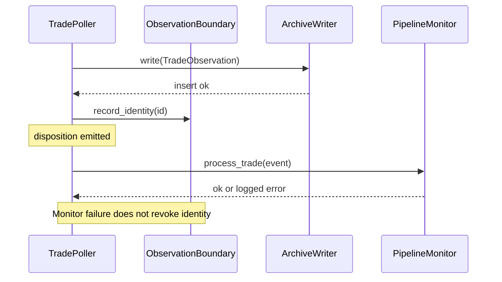
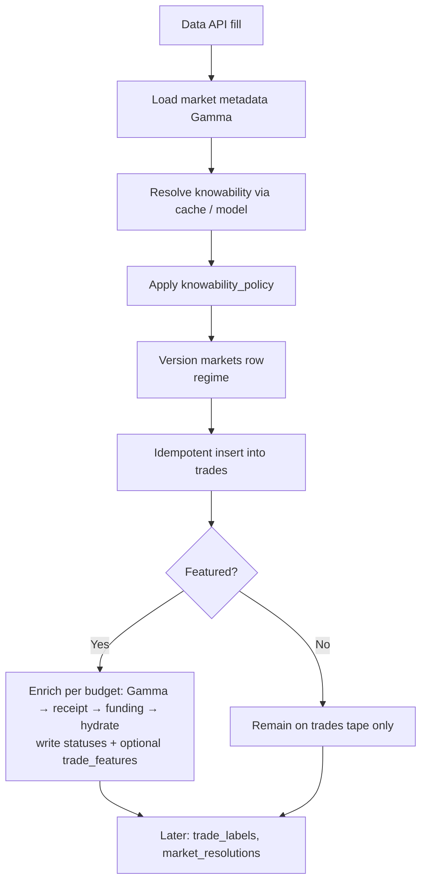

# Data collection spec: per-trade variables for insider detection

Background primer (Polymarket, chain basics, data sources): `[docs/data-collection-primer.md](docs/data-collection-primer.md)`. Implementation sequencing and process wiring: `[docs/research-archive-roadmap.md](docs/research-archive-roadmap.md)`. Spec Kit activation order (including proposed `005`–`009`): `[specs/README.md](specs/README.md)`.

## How to read this

We collect roughly 100 analytical variables across nine levels for research on insider-style trading patterns. Prefer Polymarket's public APIs, Polygon logs, and Dune where it helps. Do not rely on manual tagging, paid address labels, order-book capture, or news research. Persist trade facts as of each fill's timestamp. Add outcome and after-trade fields once they are knowable. Tables, retention, and market coverage are under Data storage architecture.

**Jump to variable tables:** [1. Raw trade](#1-raw-trade-record-real-time) · [2. Single-trade](#2-single-trade-features-real-time) · [3. Market context](#3-market-context-at-trade-time-real-time) · [4. Wallet profile](#4-wallet-profile-as-of-the-trade-real-time) · [5. Wallet in market](#5-wallet-in-this-market-real-time) · [6. Network](#6-cross-wallet-and-network-features-real-time) · [7. Labels](#7-market-resolution-and-per-trade-outcomes-labels-only) · [8. After-trade](#8-after-trade-behaviour-labels-only) · [9. Provenance](#9-provenance)

If the Cursor markdown preview stops mid-document, use the source editor (`Cmd+F` → `## 1. Raw trade`) or open this file on GitHub / with another Markdown viewer—the tables are present in the file after the architecture sections.

### Codes used in the tables


| Column   | Values                                                                                                                                                                                                                                                                                                                                                                                                                                                                                                                                                                                                                                                                                      |
| -------- | ------------------------------------------------------------------------------------------------------------------------------------------------------------------------------------------------------------------------------------------------------------------------------------------------------------------------------------------------------------------------------------------------------------------------------------------------------------------------------------------------------------------------------------------------------------------------------------------------------------------------------------------------------------------------------------------- |
| Source   | Where the value comes from. `API` = Data API v2 (`/v2/trades`, `/v2/activity`, `/v2/resolutions`). `Gamma` = market and event metadata and resolution. `CLOB` = price history. `Chain` = Polygon logs (fill receipts, redemptions). `Dune` = curated `polymarket_polygon` tables synced into a local cache. `Model` = cheap structured decision model or LLM over market text (for example Jev). `Derived` = computed from your own stored trades.                                                                                                                                                                                                                                          |
| Priority | `Core` = needed for the first models. `Useful` = adds signal or helps rule out false positives. `Optional` = research extra.                                                                                                                                                                                                                                                                                                                                                                                                                                                                                                                                                                |
| Feasible | Verified against live APIs, OpenAPI schemas, Gamma responses, Polygon receipts, and Dune's curated catalog — do not assume availability from the Source label alone. Feasible describes **coverage reliability**, not “skip this field.” `Yes` = verified available for every trade near real time at scale (API and/or your own Polygon log index, plus your stored trade feed for Derived). `Partial` = attempt collection; expect material gaps, enrichment holes, V1- or V2-only fields, or lagged cache/indexer paths — persist what you get and explain holes with status columns (for example `receipt_status`), never treat null alone as “not attempted.” `Later` = not knowable at trade time, but collect on the delayed schedule at scale. `No` = stated path does not work for every trade in real time at scale; do not pretend it does — find a substitute, defer, or leave explicitly out of scope. |
| Notes    | General guidance for the row (how to compute, where to join, when Later fields fill). `—` means nothing beyond the other columns.                                                                                                                                                                                                                                                                                                                                                                                                                                                                                                                                                           |
| Concern  | Why Feasible is Partial or No, enrichment holes, reliability traps, infra that can fail, or soft and heuristic bounds. `—` when Feasible is Yes or Later and no material issue is called out.                                                                                                                                                                                                                                                                                                                                                                                                                                                                                               |
| Table    | Physical home when persisted: `trades`, `markets`, `trade_features` (sections 2 through 6 when materialized; otherwise compute in analysis from trade-time sources), `trade_labels`, `market_resolutions`, `proxy_funding`, `wallets`, `funder_fanout`. Optional later: `risk_assessments` if a scoring pass is added. Snapshot tables (`markets`, Dune owner fields) use `known_at` for trade-time joins. Event-sourced funding/hydrate facts rebuild by event time (see Versioned dimensions).                                                                                                                                               |


### Collection rules

1. **Persist the feed, then derive.** Ingest all-participant observations (`taker_only=false`) for markets Knowability admits. Store one row per API observation (maker and taker). The API has no maker/taker role field. Market-level aggregates count each match once via a fill fingerprint (see `trades` under Canonical tables). Wallet-level features and hydrate use every row for that `proxy_wallet`. You can recompute feature definitions from facts you stored, but you cannot recover fills you never wrote. Quiet fills must leave a `trades` row; signal gating must never decide whether a fill is stored.
2. **Prevent data leakage.** Trade-time and near-real-time features (sections 1 through 6) must come from information available at or before the trade fill. You must also be able to collect them within a few minutes of settlement. Allowed sources include the API row; Gamma/UMA/Dune-owner via last `markets`/`proxy_funding` snapshot with `known_at` at or before `trade_ts`; Transfer-log funding and lifetime hydrate rebuilt from events with event time before `trade_ts` (not from a hydrate/`proxy_funding` snapshot whose `known_at` is after the trade); on-chain receipt decode; and derived windows over fills already stored. Do not treat a field as trade-time if it only appears hours later, needs a post-hoc research pass, embeds future prices, outcomes, or follower flow, or is joined from the latest snapshot when you recompute later. Later analysis of the same stored row must use that same cutoff.
3. **Labels stay out of that trade's trade-time features.** Fill sections 7 and 8 and resolution joins later: after 1 hour, after 24 hours, at resolution, and at resolution plus 30 days. Those fields evaluate the trade after the fact. Once they are in the past, they may feed trade-time features for later trades by the same wallet. Never write them into that trade's sections 1 through 6 or its `trade_features` row. This pipeline collects data first and does not require live inference. The trade-time versus label split is still a storage contract (and the firewall a future live decision/execution consumer must respect).
4. **Version everything.** Record feature versions, knowability-policy versions, enrichment-budget versions, and source versions so older rows stay interpretable when definitions change.
5. **Cold start and burn-in.** Do not backfill the historical global tape. Collect market-wide windows forward from `archive_start_at` so they fill over time. On first featured sight of a wallet, you may hydrate that wallet's lifetime aggregates once (see section 4, wallet profile). Cold start does **not** mean “all data is unusable for a while.” Durable fill facts on `trades` are valid from day one. What is systematically wrong—not merely sparse—are **path-dependent windowed** features (24h/7d denominators, λ, burst origin, wallet-in-market ranks, and similar sections 2–6 lookbacks) until the archive has burned in. See Cold-start burn-in policy.
6. **Same-second total order.** For “before this trade,” burst origin, entry rank, signed canonical-leg picks, and similar ties, order by `(trade_ts, block_number, log_index, observation_id)`. Missing `block_number` / `log_index` sort after peers that already have locators at the **as-of** instant used for that computation. See **Order as-of enrichment contract** below—this rule alone is not a stable live↔research contract.
7. **Flag incomplete tape windows.** Keep computing windowed market features when ingest proof fails; set `data_complete` beside them (section 9). Do not null features only because the flag is false/null. Primary analysis on `data_complete=true`; sensitivity on false/null.
8. **Assessments are not the tape.** `risk_assessments` (monitor scoring evidence) is optional and sparse. It must never substitute for `trades`. Market windows, denominators, and `data_complete` are rebuilt from the admitted `trades` tape plus gap markers.
9. **Partial is still collect.** `Feasible=Partial` means the value will sometimes be missing or delayed, not that the collector should ignore the field. Persist available values for Core and Useful Partial rows; record per-arm status when enrichment can fail or skip. Phase sequencing may delay *when* an expensive Partial path is wired (for example Chain receipts in Phase B platform, with Core/Useful convenience materialization in B.1/B.2), but the long-run archive still aims to collect those fields. `Later` waits for its schedule. `No` stays out until a working path exists.

### Order as-of enrichment contract (locked)

Rule 6’s sort key is well-defined, but **without** `block_number` / `log_index` the total order among same-`trade_ts` fills is convention-dependent: missing locators sort after enriched peers, so burst originator, entry rank, and signed canonical-leg picks **move** when receipts later fill locators. A rematerialization that uses post-enrichment locators can disagree with what a live consumer would have seen minutes after the fill.

**Locked (Phase B owns materialization; do not pretend A0 tape order is live-stable):**

1. Treat order-dependent Derived fields (burst origin / leader, entry rank, same-second “before this trade” membership, signed canonical-leg choice when ties remain) as **as-of** values. Every materialized write must record which contract produced them.
2. Two allowed contracts — never mix silently in one primary study or one live decision path (table below).
3. Do **not** overwrite a frozen `live_as_of` row in place when a peer’s receipt arrives later. Rematerialize under a new `feature_version` (and/or `order_as_of_contract=fully_enriched`) if you want the post-receipt order.
4. A0 does not need to freeze ranks (no featuring/`trade_features` yet). The instability is still real for any early analysis that applies rule 6 on a partially enriched tape—label that stratum or wait for Phase B’s contract.
5. Rejected: “rematerialize from warm facts always equals live”; or sorting by ingest arrival / `observation_id` alone while claiming on-chain total order.

| Contract | Locators used | Use |
| --- | --- | --- |
| `live_as_of` | Only locators known at feature decision time (peers still missing locators sort after per rule 6) | Default for any future live decision/execution consumer; freeze the computed fields (and `feature_version` / `order_as_of_contract`) on `trade_features` or equivalent |
| `fully_enriched` | Rematerialize after receipts using locators then present | Research / sensitivity only when labeled; may disagree with `live_as_of` |

## Repository foundation gap and required fix

### Current repo behavior (gap)

Slice 001's `TradePoller` already acquires all-participant public trades and proves a Redis complete-through boundary, but the live monitor path does **not** persist a durable Postgres fill tape. Most observations are handed downstream as in-memory `TradeEvent` values; Postgres typically receives only signal-bearing (or detector-skip) `risk_assessments`, plus opportunistic wallet/funding rows. Quiet fills leave no durable row.

That blocks this collection contract: market windows, denominators, burst/leader structure, and `data_complete` analysis cannot be rebuilt from storage. It also blocks any later decision or trading consumer that needs honest trade-time market context. Ingest without a tape is monitoring, not the archive this document specifies.

A second handoff gap: the poller currently invokes consumers with `observation.event` only, dropping slice 001 `identity`. Archive inserts require that identity as `observation_id`.

### Required Phase A0 fix (blocking)

Before featuring, labels, versioned-market completeness, or any future execution work:

1. **Observation bus** — replace today’s single `on_trade(TradeEvent)` retain-always path with the fan-out contract below (see Observation fan-out contract). Emit `TradeObservation` (event + `identity` + provenance + raw payload). Keep a deprecation adapter for `TradeEvent`-only monitors if needed. **Honesty (2026-11-20):** slice `005` implements dual-mode delivery when `ARCHIVE_ENABLED=true`; monitor-only default remains retain-after-monitor. Full gate closure is tracked in `specs/005-research-trade-archive/tasks.md` Phase 8.
2. **Idempotent `trades` insert** — every observation writes Postgres immediately on the hot path. Unique key `(trade_ts, observation_id)` where `observation_id` is slice 001's observation `identity` (do not redefine the tuple; size/price canonicalization stays in slice 001). Restarts must not duplicate facts. Do not wait on Gamma, knowability caches, or Jev.
3. **Durable gap markers (A0)** — copy ingest loss / re-anchor markers out of Redis-only state so research survives TTL and can derive `data_complete`. **Versioned `markets` / knowability (A1)** follow in a separate bounded slice and must not block this insert.
4. **Fan-out + 001 amendment** — archive write is required for collection; detect/alert is failure-isolated on the same bus. Exact exception isolation, `EMITTED` meaning, and identity retain ownership are locked in Observation fan-out contract and must appear in the owned slice 001 `observation-boundary.md` amendment. A durable gap marker alone is not enough, and an archive-only parallel proof model is not allowed.

Reuse slice 001 polling, coverage, and boundary proof. Do not invent a second global feed. Do not overload `risk_assessments` as the fill grain.

### Observation fan-out contract (precise — do not guess)

Today `[TradePoller._deliver_one](src/polymarket_insider_tracker/ingestor/trade_poller.py)` has **one** callback: `await self._on_trade(observation.event)`, then unconditionally `record_identity` even if the callback raised. A0 must not leave “ordered, failure-isolated bus” as prose. The 001 amendment + A0 plan must implement the following.

**Consumers (fixed order per observation):**

1. **Archive** (required when archive writing is enabled) — idempotent `trades` insert (+ raw); may accept into durable outbox under policy (b).
2. **Monitor** (optional) — existing `Pipeline.process_trade` / detect-score-alert path; receives at least `TradeEvent` (preferably full `TradeObservation`).
3. **Future decision/execution** — reserved slot; interface only in A0; must not run order code.

**Who owns identity retain and `EMITTED`:** the amended 001 delivery step—not the monitor. Under soft-preferred policy **(a)**, `record_identity` and disposition `emitted` are authorized **only after Archive durable success** (idempotent insert acknowledged). Under **(b)**, they are authorized after Archive **accepts** the observation into durable storage **or** the durable outbox (reconciler owns eventual insert). Monitor success or failure never authorizes or revokes identity retention.

**Exception isolation (locked):**

| Failure | Effect on Archive | Effect on Monitor | Identity / `EMITTED` (policy a) | Identity / `EMITTED` (policy b) |
| --- | --- | --- | --- | --- |
| Archive raises / insert fails | Failure recorded; recovery arm applies | **Still invoked** with the in-memory observation (monitor must not assume the row is on the tape) | **Do not** retain; not `emitted` for boundary credit | Retain/advance only if outbox accept succeeded; else same as (a) for retain |
| Monitor raises after Archive success | Unchanged (row stays durable) | Logged; monitor error counter; must not undo archive | **Retain**; `emitted` | Same |
| Monitor raises and Archive never succeeded | N/A | Logged | **Do not** retain | Per outbox accept only |

Constitution IV: assessment persist failure inside Monitor must not block alert dispatch; that is internal to Monitor and orthogonal to Archive retain.

**Deprecation window:** `TradePoller` may still accept a legacy `on_trade: TradeCallback` by wrapping it as the Monitor consumer behind the fan-out driver. New wiring passes an explicit fan-out (Archive + Monitor). Legacy single-callback mode without Archive is monitor-only (archive disabled)—not an accidental skip of the tape when archive is enabled.

#### Sequence: happy path (policy a)



#### Sequence: Archive fails (policy a)

```mermaid
sequenceDiagram
  participant Poller as TradePoller
  participant Boundary as ObservationBoundary
  participant Archive as ArchiveWriter
  participant Monitor as PipelineMonitor

  Poller->>Archive: write(TradeObservation)
  Archive-->>Poller: fail
  Note over Poller: no record_identity; not emitted
  Poller->>Monitor: process_trade(event)
  Monitor-->>Poller: ok or logged error
  Note over Poller,Boundary: restart may re-emit while in reach
```

#### Sequence: Monitor fails after Archive ok (policy a)

```mermaid
sequenceDiagram
  participant Poller as TradePoller
  participant Boundary as ObservationBoundary
  participant Archive as ArchiveWriter
  participant Monitor as PipelineMonitor

  Poller->>Archive: write(TradeObservation)
  Archive-->>Poller: insert ok
  Poller->>Boundary: record_identity(id)
  Poller->>Monitor: process_trade(event)
  Monitor-->>Poller: exception logged
  Note over Boundary: identity remains; checkpoint may advance after page
```

#### Sequence: crash between Archive ok and record_identity (001-amended crash semantics)

```mermaid
sequenceDiagram
  participant Poller as TradePoller
  participant Boundary as ObservationBoundary
  participant Archive as ArchiveWriter

  Poller->>Archive: write(TradeObservation)
  Archive-->>Poller: insert ok
  Note over Poller: crash before record_identity
  Note over Archive,Boundary: row durable; identity missing
  Note over Poller: restart re-delivers; insert idempotent no-op; then record_identity
```

Crash between `record_identity` and page-level checkpoint advance stays as today’s 001 rule: next cycle sees identity, suppresses duplicate emission. Policy **(b)** replaces the Archive-fail diagram with outbox accept → retain + reconciler retry; diagrams for (b) belong in the 001 amendment once (b) is chosen.

**Implementers must not guess:** if code still does “one callback then always retain,” it violates this contract and the 001 amendment.

### Write-failure and identity retention (slice 001 contract amendment — not 005-local)

This is an amendment to slice 001’s observation-boundary contract, not a detail that Phase A / slice 005 may invent locally.

Slice 001 today defines (see `[specs/001-supported-trade-ingestion/contracts/observation-boundary.md](specs/001-supported-trade-ingestion/contracts/observation-boundary.md)` and `[status-and-config.md](specs/001-supported-trade-ingestion/contracts/status-and-config.md)`):

- identity is written **after the trade callback returns**;
- the checkpoint advances **after the whole proven page is delivered**;
- durable loss reasons are exactly `{horizon-expired, restart-beyond-horizon, continuity-mismatch}`.

`TradePoller._deliver_one` retains identity even when the consumer callback fails, then the cycle can advance the checkpoint. Under that contract, a restart will not re-emit the fill. Combining that behavior with “advance the Redis boundary and only write a durable write-failure / gap marker” makes incompleteness **visible but unrecoverable**: the marker records a hole, retained identity prevents re-delivery, and rule 1 (“persist the feed, then derive”) fails permanently for that observation.

**Rejected default:** advance-with-marker with no reconciliation or retry arm, implemented only inside 005 without amending 001.

**Owned amendment required before archive implement.** Write-failure markers, fan-out failure isolation, any new loss reason, and any change to when identity is retained must be specified as an owned update to slice 001’s contracts (at minimum `observation-boundary.md` and ingest status in `status-and-config.md`), with gap-register / tasks evidence under 001 or an explicit cross-slice contract that still names **001 as the boundary owner**. Without that, implement either silently breaks 001 semantics or ships an unauthorized parallel proof model.

**Locked (2026-11-18): policy (a) — retain identity only after durable archive insert.** The archive consumer’s successful Postgres write (idempotent on `(trade_ts, observation_id)`) is what authorizes `record_identity` / emission credit for that observation. Monitor or alert failure must not block archive success or identity retention; archive failure must not retain identity and must not silently advance the complete-through boundary past that fill. Policy **(b)** (advance with marker plus durable outbox reconciliation) remains a documented alternative only if a later versioned 001 amendment explicitly switches; it is **not** the A0 default. Marker-only advance remains rejected. Slice 005 implements **(a)**; it may not redefine the boundary unilaterally.

**Locked (2026-11-18): checkpoint back-pressure under (a).** While any archive-destined observation on the current page (or owed set) lacks a durable insert, **do not** advance the Redis complete-through checkpoint past that observation. Retry insert with bounded backoff; keep the fill eligible for re-delivery without identity credit. Surface archive/ingest health as `degraded` then `down` per the Dual-use health SLOs below—**do not** escape a long outage by advancing the boundary anyway (that reintroduces permanent holes). If, despite stalling, a fill becomes unreachable from live acquisition before it is ever inserted (process loss, crash without in-memory retry payload, or equivalent), record a durable write-failure / gap marker, set `data_complete=false` for affected windows, and alarm—denominators are not restored for that identity.

### Recovery story for write-failed / gap-marked rows (A0 acceptance)

`data_complete` and durable gap / write-failure markers are **necessary but not sufficient** for Phase A0 acceptance. Markers make holes visible; they do **not** restore market denominators, window stats, or any Derived feature that needs the missing fill on `trades`. A0 must name how write-failed observations are restored—or explicitly accept them as permanent with alarms—before implement.

**Rejected as A0 acceptance:** shipping markers (or `data_complete=false`) alone with no restore path and no explicit permanent-loss + SLO-alarm contract.

**Recovery mechanisms (choose with the 001 amendment’s (a) or (b); do not leave implied):**

| Policy | How missing rows get onto `trades` | What is durable besides the marker | When a hole becomes permanent |
| --- | --- | --- | --- |
| **(a) Re-emit until insert** | Identity is not retained until idempotent archive insert succeeds, so the poller can re-deliver the observation from the live acquisition path while it remains in reach | Not required for A0: no outbox. Core hot `raw_row_json` is still stored for forensics/debug; it is **not** the primary restore path under (a) | If the fill never becomes durable before it ages out of reachable acquisition / recovery horizon, the hole is **permanent**: keep the gap marker, set `data_complete=false` for affected windows, fire rate/SLO alarms. Denominators are **not** restored for that interval |
| **(b) Durable outbox + reconciliation** | Boundary may advance, but a durable outbox (or equivalent) stores enough payload to idempotently insert `(trade_ts, observation_id)` without global historical backfill. A bounded reconciler retries until success or explicit abandon | Outbox row / payload + write-failure marker; success clears or narrows the marker | After abandon (retry budget / wall-clock SLO exhausted): permanent hole, `data_complete=false`, rate/SLO alarms. Denominators remain unrestored for abandoned identities |
| **Permanent-with-alarms only** | No restore attempt | Marker + alarms | Immediate permanent hole |

**Locked for this archive:** implement policy **(a)** (re-emit until insert; identity after durable success) as the A0 default with checkpoint stall as above. Do **not** ship “permanent-with-alarms only” as the default, and do not implement **(b)** unless a later 001 amendment switches. Hot raw capture assists forensics/debug under (a); it is **not** the primary restore path.

**A0 acceptance checklist (recovery):**

1. Gap / write-failure markers exist and feed `data_complete` per the schema and completeness rules below.
2. The chosen restore path ((a) re-emit or (b) outbox reconciler) is specified, tested, and observable.
3. Exhausted / unreachable cases are explicitly permanent: markers retained, alarms fired, denominators **not** claimed complete.
4. Success of restore removes the observation from the failure set (and clears or narrows the marker) so the tape can again support denominators for that identity.

### Outcome-repair quality (A0 tape ≠ label-ready)

Splitting A0 (tape) from A1 (markets / Gamma) is right for latency, but it creates a **label-quality** hazard. The public trades API often returns `outcome_index=999` or empty `outcome`. Side-of-market, binary Yes-fold, and Phase C `bet_won` (and related labels) need **repaired** outcomes via `token_id` → Gamma. If A1 lags—or repair stays `unrepaired` at scale—Phase C inherits garbage even though the `trades` tape “exists.”

**Locked:**

1. **A0** always stores raw `outcome` / `outcome_index` and initializes `outcome_repair_status` to `not_attempted` (or `not_needed` when the API already supplied a usable label). A0 does **not** block insert on Gamma.
2. **A1’s first priority** (ahead of Jev / knowability niceties) is async, non-blocking Gamma outcome repair: set `outcome_repaired`, `outcome_index_repaired`, and `outcome_repair_status` ∈ {`ok`, `unrepaired`, `not_needed`}. Never invent an outcome.
3. **`outcome_repair_status` is a first-class quality KPI**, not a buried side field. Export and alert on rates: share of rows with thin API labels (`999`/empty) that are still `not_attempted` or `unrepaired` after a versioned lag (provisional: repair attempted within **minutes** of insert; `unrepaired` rate among thin rows below a versioned ceiling before Phase C primary runs—starting point **≤5%** unrepaired among thin rows over a trailing day, revise with ops data).
4. **Phase C gate:** primary `trade_labels` / win-loss joins that need side-of-market must filter to `outcome_repair_status` in {`ok`, `not_needed`} (or an explicit sensitivity stratum for `unrepaired`). Do not treat unrepaired thin labels as Core ground truth.
5. Outcome repair is **thinner than full A1 knowability**. If A1 scope slips, still ship repair + minimal token→outcome market metadata before Jev caches; do not hold repair behind regime-model polish.

**Rejected:** assuming “tape exists ⇒ labels can run”; or leaving repair status unmonitored until someone notices `bet_won` is nonsense.

### Label schedule fidelity (Phase C — locked)

Follower / after-trade labels (+5m / +1h / +24h, and similar fixed lags) need **schedule fidelity**, not only a durable tape. If label jobs lag or skip during outages and never catch up, fields such as `follower_volume_1h_after` become **selection-biased toward quiet periods** that happened to get labeled on time—busy outage windows drop out of the labeled set.

**What is still correct when a job runs late:** computing the label from the admitted tape over the **fixed window** `[trade_ts, trade_ts + H]` (plus `data_complete` for that window). Lateness alone does not change the definition if catch-up uses that window.

**What goes wrong:** dropping due work, “best effort when the cron wakes,” or only persisting labels for rows processed within a soft SLA—so primary studies silently condition on “job was healthy.”

**Locked Phase C rules:**

1. **Due-queue, not fire-and-forget cron.** Every eligible `observation_id` gets a durable due time per lag (`trade_ts + H`). Jobs claim due work; failures leave the row due for retry.
2. **Catch-up after outages is required.** When the worker returns, it processes overdue dues from the tape—do not leave permanent holes just because the +1h slot was missed wall-clock.
3. Persist per label (or per lag arm): `label_due_at`, `label_computed_at`, `label_schedule_lag_s` (= computed − due), and `label_schedule_status` ∈ {`on_time`, `late`, `skipped`, `pending`, `failed`} (names may vary; semantics are normative). Version soft SLA thresholds (provisional: **on_time** if lag ≤ 15m for +1h arms; ≤ 2h for +24h arms—revise with ops).
4. **`label_schedule_*` is a first-class quality KPI** beside tape `data_complete` and `outcome_repair_status`. Export/alert on overdue backlog, skip/fail rate, and share of primary-eligible rows with `late`/`skipped`/`failed`.
5. **Primary analysis gate:** for lag-window after-trade labels, require (a) the after-window tape `data_complete` (or labeled sensitivity), and (b) `label_schedule_status` in {`on_time`, `late`} with catch-up completed—not `skipped`/`failed`/`pending`. Stratify `late` vs `on_time` when lag could correlate with market stress. Do **not** treat “only rows labeled while jobs were healthy” as the default population without naming that bias.
6. Resolution-timed labels (`bet_won`, holding-to-resolution, etc.) follow resolution due times, not the +1h cron; still record computed-at / lag vs `resolved_at` (or policy due).

**Rejected:** assuming delayed labels are unbiased because the tape exists; or measuring follower volume only on the successfully cron’d subset without a schedule KPI.

### Cold-start burn-in policy (analysis readiness)

No global backfill is intentional. That choice has a consequence: early **windowed** Core features are path-dependent and biased low/unstable for days to weeks, not just “missing a few rows.” Treating underbuilt 24h/7d denominators, λ, burst origin, or wallet-in-market ranks as signal overfits to archive age.

**What is usable immediately after A0 starts**

- Admitted `trades` facts (identity, side, price, size, timestamps, raw hot payload, provenance).
- Non-windowed attributes once available (e.g. repaired outcome after Gamma, later labels on their delayed schedule).
- Wallet lifetime hydrate outputs when that arm has completed for a featured wallet (still subject to hydrate partial flags).

**What is not analysis-ready until burn-in**

- Any feature whose definition looks back over a market/wallet window that can include time **before** `archive_start_at` (or before the market’s first retained fill in this archive): 24h/7d volume and size denominators, Kyle λ, burst/leader structure, entry ranks, and similar Derived windows in sections 2–6.

**Locked burn-in policy (version as `burn_in_policy_version`):**

1. Persist `archive_start_at` (UTC) on every `trades` row and in collector config—the instant continuous all-participant archive collection began for this deployment.
2. Default **calendar burn-in:** windowed Core features for a trade are analysis-ready only if  
   `trade_ts >= archive_start_at + burn_in_horizon`.  
   Provisional default: **`burn_in_horizon = 7 days`** when the longest Core lookback in the study is ≤7d; use **`14 days`** when studies include 7d windows plus margin for quiet markets / `data_complete` churn. The Spec Kit / analysis config must state which horizon applies; never silently use 0.
3. Default **completeness burn-in (AND):** also require that, over a trailing 24h ending at `trade_ts` (or at analysis time for batch jobs), the share of windowed rows with `data_complete=true` is ≥ a versioned threshold (provisional **95%**). Calendar burn-in alone is not enough if ingest/write-failure holes dominate early ops.
4. Persist or derive an explicit readiness flag for research exports (e.g. `window_features_analysis_ready`) rather than relying on analysts to remember. Primary registered studies filter to ready rows; sensitivity may include burn-in / incomplete windows with that stratum labeled.
5. Live monitor alerts (slice 003/004 path) are **not** automatically gated on research burn-in unless a later decision/execution slice says so. Burn-in is a **research/label-training contract** first; a future trading consumer must re-state whether it refuses to act before burn-in.

**Rejected:** computing windowed Core features from day one and treating them as primary signal; or saying only “data_complete” without an `archive_start_at` horizon (completeness does not fix empty pre-archive history).

### Durable gap / write-failure schema (`ingest_gap_events`)

Redis `loss-events` (slice 001) are a **bounded operational buffer** (newest 50). Research needs a durable Postgres copy that outlives Redis trim/TTL. Write-failure is a **new reason and grain**—not a silent overload of `{horizon-expired, restart-beyond-horizon, continuity-mismatch}`.

**Table:** `ingest_gap_events` (name may vary; grain and columns are normative).

| Column | Type | Meaning |
| --- | --- | --- |
| `gap_id` | UUID / bigserial | Surrogate primary key |
| `source_id` | text | Same ingest source namespace as Redis (`polymarket:ingest:<source-id>:`) |
| `class` | enum | `ingest_loss` or `write_failure` — research stratification (see `data_complete` below) |
| `reason` | text/enum | For `ingest_loss`: `horizon-expired`, `restart-beyond-horizon`, or `continuity-mismatch` (001). For `write_failure`: `archive_insert_failed`, `archive_insert_abandoned` (and optionally `outbox_accept_failed` under (b)) |
| `from_time` | timestamptz / epoch s | Interval start (ingest loss) or event time (write failure; usually the observation’s `trade_ts`) |
| `to_time` | timestamptz / epoch s | Interval end (ingest loss) or same as `from_time` / null for point write failures |
| `observation_id` | char(64) null | Required for `write_failure` when the identity is known; null for interval ingest losses |
| `pages_examined` | int null | Copied from 001 loss JSON when present |
| `detected_at` | timestamptz | When the system detected the gap/failure |
| `recorded_at` | timestamptz | When the durable row was written |
| `resolved_at` | timestamptz null | Set when the hole is closed (ingest gap closed without loss, or write-failure restored / abandoned terminalized) |
| `status` | enum | `open`, `resolved`, or `abandoned` |
| `redis_payload` | jsonb null | Optional verbatim copy of the Redis loss-event JSON for ingest_loss rows |
| `detail` | jsonb null | Write-failure diagnostics (redacted): error class, retry count, outbox id—never secrets |

**Ingest-loss copy path:** on each Redis `loss-events` push (or equivalent boundary write), upsert/insert a durable `ingest_loss` row keyed so Redis re-trims do not create duplicates (e.g. unique on `(source_id, class, reason, from_time, to_time, detected_at)` or a hash of the Redis payload). Redis remains the hot operational list; Postgres is the research ledger.

**Write-failure path:** Archive fan-out failures insert/update `write_failure` rows at observation grain (`observation_id`). Successful restore sets `status=resolved` and `resolved_at`. Exhausted recovery sets `status=abandoned`, `reason=archive_insert_abandoned`.

**001 amendment:** extend loss/status vocabulary so write-failure is not an undeclared side channel. Redis may mirror write-failure for ops, but the durable schema above is authoritative for research.

#### How `data_complete` treats the two classes

| Class | What it means | Effect on windowed `data_complete` | Stratification |
| --- | --- | --- | --- |
| `ingest_loss` | Provider/proof hole: fills may never have entered the collector | Any trade-time window that intersects `[from_time, to_time]` for an `open` or unresolved ingest loss → `data_complete=false` (or null if unknown overlap policy prefers null—default **false**) | Sensitivity: ingest-loss-only incompleteness |
| `write_failure` | Observation was seen; durable `trades` row missing or abandoned | Any window that needs that `observation_id` / its `trade_ts` for denominators → `data_complete=false` while `status` is `open` or `abandoned` | Sensitivity: persist-loss-only incompleteness |

**Locked:** both classes **fail** completeness for affected windows (rule 7 still applies: do not null features solely because the flag is false). They are **not** collapsed into one opaque “gap” for analysis: persist `class` (and `reason`) so primary studies can require `data_complete=true`, and sensitivity slices can separate provider loss from our persist loss. `resolved` write-failures no longer spoil windows once the `trades` row exists; `abandoned` write-failures continue to spoil forever for that identity’s contribution (denominators unrestored).

Optional companion fields on materialized features: `data_complete_ingest` / `data_complete_persist` booleans whose AND equals `data_complete`, if Phase B wants finer flags without changing the Core `data_complete` meaning.

### Dual-use health and `/ready` (not “leave 003 alone”)

Slice 003 makes PostgreSQL a required dependency for `GET /ready`. Once the archive lands, Postgres is the **trades tape**, not only a sparse `risk_assessments` store. Saying “leave `/ready` alone” while also requiring archive failures to be observable is underspecified: operators can see a ready monitor while the research tape is dead.

**Rejected:** unchanged 003 readiness semantics with archive failures only in logs; or failing `/ready` on every assessment-persist miss in a way that blocks alerts (constitution IV).

**Locked health model (when archive writing is enabled):**

- **Postgres unreachable** — Required dependency down (existing 003). Effect on ready: fail ready (503). Effect on alerts: no new authorized work assumed.
- **Archive tape component up** — Recent durable inserts succeeding within SLO when writes were attempted; or quiet market with no archive-destined attempts and no open backlog. Ready may be true. Alerts unchanged.
- **Archive tape degraded** — Transient write errors or short owed backlog inside the versioned SLO; recovery in progress (checkpoint may be stalled under policy (a)). Ready may stay true (same pattern as 003 ingestion degraded). Must not block alerts.
- **Archive tape down** — Sustained insert failure or owed backlog beyond the versioned SLO while archive is enabled. **Fail ready** — a ready process must not claim collection health with a dead tape. Must not block an otherwise authorized alert attempt (constitution IV).

Operator red-flag catalog (ingest, tape, repair, featuring/enrichment, funding honesty limits): [docs/collection-honesty-monitoring.md](docs/collection-honesty-monitoring.md). Enrichment/repair diagnostics may degrade `/health` without failing tape ready.
- **Assessment persist failure** — Monitor evidence write failed. Does **not** by itself mark archive down; may be its own observable signal. **Must not** block or delay alert dispatch (constitution IV).

**Provisional tape SLOs** (version as `archive_tape_health_slo_version`; revise after ops data—starting points for the 003 amendment):

| State | Enter when (archive writing enabled) |
| --- | --- |
| `up` | No open owed archive inserts older than **30 seconds**, and no failed archive insert attempt in the last **60 seconds**. Quiet markets (no archive attempts and no backlog) stay `up`. |
| `degraded` | At least one archive insert failure in the last **60 seconds**, **or** any owed (not-yet-durable) archive observation older than **30 seconds** but younger than **5 minutes**. Ready may remain true. |
| `down` | Any owed archive observation older than **5 minutes**, **or** every archive insert attempt failed for a trailing **5 minutes** during which at least one attempt occurred. Fail `/ready` (503). |

Do **not** mark the tape `down` solely because no trades arrived (quiet market). Age of “owed” observations is measured from first archive-destined delivery attempt for that identity under policy (a).

Rules:

1. When archive writing is enabled, expose a first-class health **component** (for example `trade_archive` / `trades_tape`) distinct from generic “postgres up.”
2. Component vs readiness: follow slice 003’s `up` / `degraded` / `down` vocabulary. Only `down` fails `/ready`. The table above is the initial versioned backlog / failure SLO; the 003 amendment may revise numbers but not the quiet-market exemption or constitution IV.
3. Constitution IV stays intact: durable **assessment** persistence must not block alerts. Tape health failing `/ready` is about **process readiness for collection**, not about suppressing a dispatch that already qualified.
4. Monitor-only runs (archive writer disabled) keep current 003 `/ready` semantics without an archive component.
5. This is an owned change to slice 003 health/readiness contracts (at least [health-endpoints.md](specs/003-safe-observable-operation/contracts/health-endpoints.md) / pipeline lifecycle) when archive is enabled—or an explicit cross-slice contract that still names **003 as the health owner**. A0 must not invent a parallel readiness story in logs only.
### Delivery phases (Spec Kit)

**Locked (2026-11-15):** the former single Phase A was too heavy for one bounded slice (observation bus + `trades`/`markets`/`ingest_gap_events` + Gamma admit/repair + knowability caches + optional Jev-on-miss + durable gap copy). Split it. “Knowability does not run per fill” only helps regime classification once metadata exists; it does **not** make Gamma cold starts free on an all-participant 5s poll.

**Hard latency rule (all A* phases):** admit / knowability / Gamma must **never block** observation emission or the idempotent `trades` insert. If classification is not ready, persist the fill immediately with regime `unknown` (and record provenance). Async or follow-up work may upgrade `markets` and repair outcomes; it must not stall the poller or the archive write path.

- **A0 — delivers:** Observation-bus fan-out; durable `trades` tape (every fill); durable ingest-gap / loss copy from Redis; section 1 fields from the API row and cheap derived values (including Partial API fields such as raw `outcome` / `outcome_index`). May stamp `unknown` knowability when A1 has not classified yet. Depends on the owned slice 001 boundary amendment **and** implements write-failure recovery policy **(a)** (retain identity only after durable insert; checkpoint stall under back-pressure)—markers alone are not acceptance. Plan must include provisional partition/index/retention/disk assumptions (see Provisional capacity)—not “Phase D later.”
  - **Acceptance:** Honest rebuildable tape + `data_complete` inputs + tested restore-or-explicit-permanent path under (a) + sized primary for interim retain; prerequisite for A1–E.
- **A1 — delivers:** Versioned `markets`; **Gamma outcome repair as first-class work** (see Outcome-repair quality); series/template knowability caches; human overrides; optional Jev-on-miss. Must **not** block A0 insert.
  - **Out of scope:** Changing A0 insert semantics; featuring budgets.
- **B — delivers:** Featuring **platform**: gate + budgeted enrichment arms (receipt / funding / hydrate plumbing, Partial statuses) + `trade_features` **grain/schema** + wallet-funding dims. Attempt Partial paths; persist statuses when incomplete. **Must** implement regime-upgrade → hot-window featured backfill enqueue (see Featuring) and enforce **two wallet-history stories** + `wallet_hydrate_status` stratification (section 4). Locked Spec Kit slice: `007-featured-enrichment`. Optional convenience snapshots in B are **not** the acceptance bar for the full §§1–6 field catalog.
  - **Out of scope:** Monitor thresholds and alerts; execution; insert-only featuring with no upgrade backfill; silent lifetime↔archive hybrids; claiming §§2–6 Core/Useful catalog completeness.
- **B.1 — delivers:** **Core field delivery** (`010-featured-core-features`): every §§1–6 Priority=`Core` row has an owned producer, storage grain, and readiness rule; honest arm producers (no fake-`ok` hydrate/funding); Core convenience snapshots materialized under `feature_version` + order-as-of; rematerialize without overwriting `live_as_of`. Covers A0/A1 gaps where Core facts were deferred or only stubbed.
  - **Out of scope:** Useful/Optional catalog (B.2); wash-adjusted Core promotion; Phase C labels.
- **B.2 — delivers:** **Useful field delivery** (`011-featured-useful-features`): remaining §§1–6 Priority=`Useful` rows so the intended catalog eventually lands under the same versioning / Partial / dualism rules. Optional rows stay Optional unless a later approved amendment promotes them.
  - **Out of scope:** Redefining Core readiness; execution.
- **C — delivers:** Delayed `trade_labels` + `market_resolutions`. **Gated on outcome-repair KPI** and **label schedule-fidelity KPI** (see Label schedule fidelity)—do not ship primary after-trade / win-loss pipelines while repair is bad or +1h/+24h jobs systematically skip/lag without catch-up.
  - **Out of scope:** Treating unrepaired `999`/empty outcomes as win/loss ground truth; treating on-time-only labeled cohorts as unbiased follower/after-trade evidence.
- **D — delivers:** Hot→warm compaction / durable export policy.
  - **Out of scope:** Long-horizon retention cost control as a substitute for A0 capacity planning.
- **E — delivers:** Future decision/execution consumer (separate approved product-boundary / constitution change).
  - **Out of scope:** Live trading — **not** authorized by this document.

Planes: **data** (A0–D) stays the source of truth; **decision** and **execution** plug into the observation bus and trade-time feature views later. Do not ship dormant order-placement modules inside collection slices. Live scoring and order placement remain out of scope for the collection phases; the leakage firewall and versioned tape are what make a later trading slice extendible without rewriting the feed. Slice ownership, observation-bus design, access topology (remote warehouse — do not download the full tape locally), and next steps: [docs/research-archive-roadmap.md](docs/research-archive-roadmap.md).


## Data storage architecture

This archive supports long-running forward research: continuous ingestion from archive start, reproducible features on collected rows, and retention measured in months to years.

Four design concerns:

1. Knowability: classify each market's information structure (series/template caches) and write fills for all regimes
2. Canonical tables: which facts are stored once, and how versioned dimensions work
3. Featuring: which stored rows get expensive enrichment
4. Retention: how detail ages (hot / warm / durable)

Storage rules:

- One fill row per observation in `trades`. Do not keep a parallel "large trades only" tape.
- Resolve knowability before insert. Admit every classified regime into `trades`, including `no_private_edge` (see Knowability). Featuring—not admit—decides expensive enrichment (see Featuring).
- **Trade-time reads follow fact kind.** Snapshot-only fields (Gamma/UMA on `markets`; Dune owner on `proxy_funding`): last version with `known_at` at or before `trade_ts`. Event-sourced fields (Transfer funding edges, lifetime hydrate inputs, fanout rebuilt from first-funding events): rebuild with event time before `trade_ts`—do not require the enrichment snapshot's `known_at` ≤ `trade_ts`. See Versioned dimensions and Collection rules, rule 2.
- When used, `trade_features` stores derived columns only and joins `trades` for price, size, and wallet.
- When a trade leaves the hot tier, compact `trades`. Do not delete fills. Durable-tier artifacts must stay addressable. See Retention.


### 1. Knowability

One market-level decision: classify how privileged knowledge can relate to the outcome, then write admitted fills. Series and template caches support that classification. All regimes enter `trades`; Featuring gates enrichment. This does not run per fill.

#### Information structure

Classify whether privileged private or insider knowledge can relate to the market's outcome before public resolution. Assign a regime once per market (first sight or when Gamma text or series changes). Do not call a decision model per fill. Version the prompt and schema; store confidence. Persist regime as a new `markets` version when it changes. Keep series/question/template caches versioned the same way. Derive trade-time flags for admitted fills from the version with `known_at` at or before `trade_ts`, not from a later overwrite.

Lookup order (first hit wins; record `knowability_label_source`):

1. Human override for a series or template id.
2. Gamma `seriesSlug` cache when present (one regime per series and policy version).
3. Exact normalized question-text cache when series is missing.
4. Normalized question template (slot out teams, tickers, dates, strikes, and so on) when matching is enabled. Examples: `SPORTS_MATCHUP_WINNER`, `CRYPTO_UP_OR_DOWN_WINDOW`, `EARNINGS_BEAT_EPS`.
5. Cheap decision model only on miss; write through to series and question caches (not free-form templates).


| Regime                   | Meaning                                                                                            |
| ------------------------ | -------------------------------------------------------------------------------------------------- |
| `no_private_edge`        | No meaningful privileged non-public informational edge before settlement is public                 |
| `private_edge_possible`  | Some party can hold a privileged non-public informational advantage before settlement is public    |
| `unknown`                | Listing does not clearly establish whether a privileged edge exists                                |


**Policy lock (amended 2026-11-27):** there is no “windowed” regime and no live `knowable_from` onset. Timing of when privileged knowledge might appear does not create another class. Privileged edge is a **single** regime (`private_edge_possible` under `knowability.v5`); do not split settlement-fact vs intermediate-factor knowledge at classification time. Historical `private_settlement_possible` / `private_factor_possible` / `never_early` / `always_latent` / `windowed` rows under earlier policy stamps remain as stored history. The `markets.knowable_from` column may remain nullable for legacy rows but is unused under `v5`.

Audit cache hits periodically and rematerialize after a policy/model-version bump. Do not mix versions in one analysis slice. Keep a small seeded random sample of featuring-rejected `no_private_edge` fills as a classifier control (not full enrichment of that population).

#### Admit / write policy

After the regime is set, write fills for that market into the archive. A versioned `knowability_policy` records how classification and write rules were applied. It runs before insert:

1. Resolve market metadata (Gamma).
2. Resolve the knowability regime (cache or model) as above.
3. Admit `no_private_edge`, `private_edge_possible`, and `unknown` into `trades`. Do not drop `no_private_edge` fills (they keep wallet and market tape complete; Featuring keeps them off expensive enrichment). Always admit `unknown` so an LLM or cache miss is not irreversible under the no-backfill rule; by default Featuring also keeps `unknown` off expensive enrichment (see Featuring). Record `knowability_label_source` and confidence.
4. Record the policy version and knowability provenance on admitted rows.

This pass has no reject-aggregates path and no force-exclude. Policy changes apply forward under a new policy version.

Supporting config (not one row per fill): versioned `knowability_policy` and knowability series/template caches. Version them and append on change when regimes or admit rules change.

### 2. Canonical tables

Which facts are stored, and how versioned dimension tables work.


| Entity               | Key                                  | Role                                                                |
| -------------------- | ------------------------------------ | ------------------------------------------------------------------- |
| `trades`             | `(trade_ts, observation_id)`         | Fill facts (who, token, price, size, time, transaction)             |
| `markets`            | `condition_id` + `known_at`          | Versioned Gamma/knowability attributes (append-on-change)           |
| `wallets`            | `proxy_wallet` + `known_at`          | Versioned wallet attributes / lifetime hydrate snapshots            |
| `proxy_funding`      | `proxy_wallet` + `known_at`          | Versioned funding edges, owner fields, recent inbounds              |
| `funder_fanout`      | `funder` + `known_at`                | Versioned count of proxies funded (fanout only grows)               |
| `trade_features`     | `observation_id` + `feature_version` | Optional stored section 2–6 columns (featured convenience snapshot) |
| `trade_labels`       | `observation_id`                     | Delayed section 7–8 outcomes / after-trade fields                   |
| `market_resolutions` | `condition_id`                       | How the market settled                                              |


`trades`. One row per admitted API observation under `taker_only=false` (maker and taker). Holds trade facts and foreign keys to market and wallet. `observation_id` is slice 001's observation `identity` (see `[specs/001-supported-trade-ingestion/data-model.md](specs/001-supported-trade-ingestion/data-model.md)`); both legs of a match are distinct rows under that tuple. The Trade schema has no liquidity-role field. Partition by `trade_ts`; unique key is `(trade_ts, observation_id)` (partition key required). Logical identity remains `observation_id`.

**Market vs wallet use of the same tape.** Observation grain ≠ match grain. Store maker and taker as separate `trades` rows (wallet features / hydrate need every leg). Market-level aggregates must count each **match** once via fill fingerprint—provisional weak `(transaction_hash, token_id, price, size)`, or strong with `log_index` when enriched. Incomplete pairs still contribute one fingerprint from the leg you have. Wallet features and hydrate use every row for that `proxy_wallet`.

**Fingerprint quality gate (locked — Phase B owns the rule; A0 does not pretend):** correct A0 `observation_id` does **not** make market aggregates trustworthy. Until Phase B locks and versions strong vs weak fingerprint (`fingerprint_version`), provisional weak keys can silently merge distinct fills that share tx/token/price/size (or fail to merge true pairs when canonicalization differs)—distorting volume, λ, burst, and size-vs-volume. Consequences:

1. A0 may optionally persist a provisional weak `fill_fingerprint` column for later rematerialization; it must **not** replace `observation_id` and must **not** be treated as Core aggregate truth.
2. Fingerprint-dependent Core/Useful market features (sections 2–6 denominators, λ, burst, fingerprint-once counts) are **not analysis-ready** for primary studies until `fingerprint_version` is locked and features are rematerialized under that version (AND burn-in / `data_complete` as elsewhere). Sensitivity strata may use provisional weak with that stratum labeled.
3. After receipts supply `log_index`, rematerialize under the strong rule for rows that have it; keep a documented fallback for unenriched rows. Do not silently mix strong and weak in one primary analysis slice without versioning.
4. Not shipping continuous research collection before Phase B does **not** remove this risk from the contract—it only means you may never run primary studies on weak-fingerprint windows. The gate still belongs in Spec Kit / exports so early or partial deploys cannot overclaim.

**Signed flow after fingerprint dedupe.** Maker and taker legs share a fingerprint but opposite `side`. The public trades API has **no** aggressor / maker–taker role. For signed market aggregates (λ, imbalance, Yes-equivalent signed notional): when a receipt (or other approved source) identifies the taker, prefer that leg; else pick one leg by Collection rule 6—never arrival order. That pick is a **stable convention**, not aggressor truth. Unsigned volume, `price_before`, and same-side burst/size counts do not use that signer (side-filter first where needed, then dedupe).

**Signed-flow / aggressor gate (locked — elevate from once-collecting checks):** λ, signed imbalance, and “who initiated” research stay **soft** until you measure convention error against receipts and treat disagreement as a first-class error class. Do not overweight those features in primary models on convention alone.

1. Keep API `side` and receipt `onchain_direction` as separate fields; market-tape signed aggregates use API `side` on the canonical leg under the convention above.
2. On a versioned sample of enriched fills (provisional **~1k** with `receipt_status` in {`ok`, `partial`}), classify disagreements: API `side` vs `onchain_direction` (complement / mint–merge / true mismatch); and convention canonical-leg vs receipt maker/taker aggressor when `OrderFilled` exposes both. Persist rates as a KPI (e.g. `signed_flow_agreement_rate` / disagreement-class histogram), not a one-off notebook.
3. **Gate before overweighting:** primary studies and any future live scoring may treat λ / signed imbalance / initiator features as first-class inputs only after that KPI is published for the deployed `feature_version` / enrichment cohort and the disagreement classes are labeled in the analysis contract. Until then: Useful/sensitivity only, or explicit “convention-signed” stratum—same honesty bar as wash-adjusted demotion and fingerprint readiness.
4. Featured-only receipts mean the validation sample is biased toward large fills; report that coverage limit beside the KPI. Expanding receipt coverage is a separate featuring decision, not a silent claim that convention equals truth on the full tape.

On-chain receipt fields (direction, counterparties, fee, log index, block number) live as columns on `trades` or on a 1:1 extension with the same grain.

#### Versioned dimensions (`known_at`)

Enrichment often writes a `wallets` / `proxy_funding` snapshot *after* the trade that triggered it, while filtering content to before `trade_ts`. A blind "last row with `known_at` ≤ `trade_ts`" miss that snapshot and diverge from live. Split by fact kind:

**Snapshot-only** (join last version with `known_at` ≤ `trade_ts`): Gamma / knowability / UMA / siblings on `markets`; Dune `owner_address` / `wallet_type` / `wallet_created_at` on `proxy_funding`.

**Event-sourced** (rebuild with event time before `trade_ts`; snapshot `known_at` is cache metadata only): Transfer-log first funding and inbounds; lifetime hydrate inputs (API trades/activity/closed positions); `funder_fanout` from observed first-funding edges. Persist those edges/rows with event timestamps so rematerialization does not depend on the post-trade snapshot's `known_at`.

On snapshot change: insert a new row with `known_at`. Do not overwrite a prior version in place. Unique on `(natural key, known_at)`. Live joins may use the latest snapshot per key. Recomputing snapshot fields from only the latest version uses future knowledge (e.g. UMA status, Dune owner).


| Table           | Holds                                                                 | Trade-time read |
| --------------- | --------------------------------------------------------------------- | --------------- |
| `markets`       | Gamma / knowability / UMA / siblings                                  | Snapshot: `known_at` ≤ `trade_ts` |
| `proxy_funding` | Dune owner fields + Transfer edges / inbounds                         | Owner: snapshot `known_at`. Funding edges: event time before `trade_ts` |
| `wallets`       | Lifetime hydrate cache                                                | Rebuild from hydrate source rows / archive with event time before `trade_ts` |
| `funder_fanout` | Fanout cache                                                          | Rebuild from first-funding events before `trade_ts` |


Version snapshots on change, not every poll. Featured `trade_features` may copy trade-time values for convenience; rematerialization follows the split above, not latest-only caches.

Sections 2 through 6 may be materialized into `trade_features` or computed later from `trades` plus the trade-time rules under Collection rules, rule 2. Never compute snapshot fields from current-only rows. After-the-fact fields go in `trade_labels` on a delayed schedule. Never write them into that trade's trade-time feature row (see Collection rules, rule 3). Window stats (trailing volume, unique traders, and so on) are computed from `trades`. There is no per-fill market-snapshot table.

#### Where the section 1–9 fields live

Per-variable Table columns in sections 1 through 9 own the mapping. Summary:


| Sections | Tables                                                    | When                                                        |
| -------- | --------------------------------------------------------- | ----------------------------------------------------------- |
| 1        | `trades`, `markets`                                       | At ingest (admitted); within minutes of the trade           |
| 2–6      | `trade_features` (or compute via trade-time versions)     | Same near-real-time cutoff (see Collection rules, rule 2)   |
| 7        | `market_resolutions`, `trade_labels`                      | After resolution / delayed market labels                    |
| 8        | `trade_labels`                                            | After lags / resolution only (see Collection rules, rule 3) |
| 9        | `trades`, `trade_features` (optional future: assessments) | Alongside the write that produced the value                 |


Research reads join these tables under explicit version columns.

### 3. Featuring

Which already-stored fills get priority enrichment and optional `trade_features`. Featuring does not decide whether the market was admitted (that is Knowability). Phase B (`007`) owns the gate + enrichment platform; **B.1** (`010`) owns Core §§1–6 field materialization; **B.2** (`011`) owns remaining Useful rows so the catalog eventually lands.


| Lever          | Decides                                                              | Effect                                                                                          |
| -------------- | -------------------------------------------------------------------- | ----------------------------------------------------------------------------------------------- |
| Knowability    | Regime on `markets` (series/question/template caches)        | All regimes admitted to `trades`; regime feeds the featuring gate                               |
| Featuring gate | Which stored trades get priority enrichment / optional `trade_features` | Regime `private_edge_possible` and per-fill notional at or above the cutoff. Default: `unknown` is **not** featured |


**Locked decision (2026-11-15; regime names amended 2026-11-27):** featuring requires both (1) knowability regime `private_edge_possible` and (2) per-fill notional at or above $5k (cutoff versioned in config). Legacy `private_settlement_possible` / `private_factor_possible` remain featuring-eligible during transition. **`unknown` is always admitted to `trades` but is not featured by default**, so a model or cache miss degrades enrichment cost instead of opening the expensive arms. `no_private_edge` rows stay on `trades` for tape and denominators but skip priority enrichment / `trade_features` (except the small classifier-control sample under Knowability). `unknown` may be opted into featuring only under a new versioned `knowability_policy` / featuring-config bump with explicit rationale—not by silently widening the default gate. Expensive enrichment applies only to the featured population. Train/serve alignment for featured-only models is out of scope beyond recording the gate. Split packages under the per-fill bar are out of scope this pass.

**Cost vs recall (real tradeoff — do not paper over):** the $5k + regime gate optimizes **enrichment cost**, not insider **recall**. Literature-suspicious patterns often involve fresh wallets, mid-size conviction, or clustered small prints. Funding, hydrate, receipts, and wash/cluster edges are therefore missing for most of the admitted tape, while unsigned market denominators still correctly claim the **full** admitted feed. That is a structural mismatch: **wash-adjusted** volumes and cluster features are systematically incomplete exactly where small coordinated flow lives. Honest response (locked 2026-11-15): keep the featuring gate for expensive arms; **demote wash-adjusted market stats from Core** to Useful/Partial diagnostics (see Design locked below and variable tables). Do not call wash-cleaned volume a Core denominator until enrichment coverage matches the claim—or until a separate approved gate widens enrichment.

**Both-leg featuring (note for Phase B — no gate change now):** featuring is per observation. One match is two `trades` rows, so independent gates can (1) spend enrichment twice on one economic match when both legs clear the cutoff, and (2) leave small opposite-side / follower legs unenriched when only the large leg qualifies. Tape pairing (same `transaction_hash` / fill fingerprint on the admitted tape) can still supply `counterparty_wallets` and basic cluster edges without featuring the small leg. Receipt-backed wash will not—those arms stay missing on unfeatured legs. Do **not** change the per-fill gate in A0/A1. Phase B should decide whether to dedupe shared arms by tx/fingerprint, add a cheap tape-only pair-assist, or keep independent featuring and accept the waste/asymmetry (wash-adjusted stats already demoted).

**Regime upgrade → featured backfill (locked for Phase B):** `unknown` not featured is the right **insert-time** cost degrade under A0→A1 async classification. It is **not** safe to evaluate featuring only once at insert. A real `private_edge_possible` market can sit as `unknown` long enough that early large fills miss the enrichment queue forever if there is no follow-up—biasing early-window research against slow-to-classify markets. This is **not** global historical tape backfill (collection rule 5 still holds). Required Phase B rule: when a market’s regime is upgraded from `unknown` (or otherwise becomes featuring-eligible) to `private_edge_possible`, **enqueue featuring evaluation** for already-stored fills on that market that (1) still sit in the **hot** retention window, (2) meet the notional cutoff under the current featuring config, and (3) have not already completed or abandoned enrichment for that `enrichment_budget_version`. A1 owns the regime upgrade; Phase B owns the enqueue/worker. Fills that have already left hot without enrichment are a permanent enrichment miss for those arms (tape row remains); do not pretend warm/cold rows are receipt-enrichable without an explicit later amendment. Upgrades **to** `no_private_edge` must not enqueue featured enrichment (classifier-control sample unchanged).

Budget, degrade order, and per-arm statuses for featured enrichment are under Enrichment decisions below.

### How a fill moves through storage

End-to-end path across the four concerns: knowability (section 1) classifies and writes; tables (section 2) insert; featuring (section 3) optionally enriches; outcome labels fill later; retention (section 4) ages the same `trades` row.




Subsets such as "above featuring threshold" or "feature version V" are queries or views. They are not parallel copies of the tape.

### 4. Retention (hot / warm / durable)

How detail ages on the same logical `trades` stream.


| Tier    | Horizon                               | Role                                                 |
| ------- | ------------------------------------- | ---------------------------------------------------- |
| Hot     | 7–30 days (configurable)              | Full detail while windows and enrichment run         |
| Warm    | Months to years while rebuilds matter | Compact facts for rematerialize and tape scans       |
| Durable | Indefinite                            | Markets, histories, labels, resolutions, gap markers |


Hot holds full fact detail, Core `raw_row_json` (unless a versioned cost flag explicitly amends that requirement), and wider receipt enrichment. It supports live 24h and 7d windows, debugging, and priority enrichment.

Warm holds compact `trades` facts only. That is enough to rematerialize features and scan the admitted tape for research.

Durable holds versioned `markets`, `wallets`, `proxy_funding`, and `funder_fanout`, knowability series/template caches, optional `trade_features` and `trade_labels`, `market_resolutions`, and ingest-gap markers.

#### Hot to warm compaction

When a `trades` row leaves the hot window, compact it. Do not delete it. Field-level rules are the Retain column in [section 1](#1-raw-trade-record-real-time).

Stays on warm `trades`:

- Identity and time: `observation_id`, `trade_ts`, `proxy_wallet`, `condition_id`, `token_id`
- Economics: `side`, `price`, `size_shares`, `notional_usdc`, and receipt-backed `onchain_direction` / `fee_usdc` / counterparties / log locators when already enriched
- Outcome keys: raw and repaired outcome fields, repair status
- Small provenance: `source`, scope/policy versions, `receipt_status`, `gamma_enrichment_status`, `wallet_history_complete`, `archive_start_at`, completeness flags on the row

Dropped at hot-to-warm:

- `raw_row_json` and other full API/debug blobs (hot only)
- Debug denormalization of market text onto `trades` when `markets` already holds the durable copy

Still available in warm analysis without sitting on warm `trades`:

- Market/event names and full Gamma context via join to `markets`
- Durable-tier tables above (`trade_features`, labels, resolutions, versioned dimensions, gap markers, knowability caches)

Compaction rules:

- Leaving hot narrows the fill. The fill remains in the archive.
- Compacting or exporting warm partitions must not strand durable-tier rows. Any trade that still has features or labels stays addressable.
- If warm partitions are copied to compressed columnar files and detached from the primary DB, record that export policy. They remain part of the same logical archive.
- `trade_features` is not hot-compacted. It is already narrow, written only for featured rows (when used), and retained under Durable.


### Physical layout and operations

- Primary store: PostgreSQL, with `trades` partitioned by `trade_ts`. Unique / primary key is `(trade_ts, observation_id)` (partition key required in the constraint).
- Collector state: a small fast store (for example Redis) may hold ingest cursors and deduplication keys. It is not the research warehouse. Phase A0 must also persist gap / write-failure markers durably so Redis TTL cannot erase completeness evidence.
- Ingest-gap markers: retain complete-through / `possible-data-loss` markers per slice 001 in Redis for ops; mirror them into durable `ingest_gap_events` (and write-failure rows) per Durable gap schema. Reachable depth is ~10k–20k rows; the ~10-minute horizon is loss-detection, not completeness. Derive `data_complete` from the durable table’s open/abandoned rows intersecting each feature window (Collection rule 7).
- Observation handoff: archive and monitor consumers share one `TradePoller`; the archive path requires `TradeObservation.identity` as `observation_id` (see Repository foundation gap and required fix).
- Backup/restore targets and whether an online feature store is required remain for implementation plans. **Partition grain, indexes, and interim retention are not “left to Phase D”** — see Provisional capacity below.

### Provisional capacity (required in A0 plan — revise with measurement)

All-participant coverage from a cold `archive_start_at` can grow disk and indexes for weeks before Phase D compaction/export exists. Qualitative “volume is heavy” is not enough. The A0 Spec Kit plan must record provisional assumptions, a disk budget, and alarms; numbers below are **starting points to load-test and revise**, not frozen SLOs.

| Assumption | Provisional default | Notes |
| --- | --- | --- |
| Partition grain | **Daily** partitions on `trade_ts` (UTC day) | Prefer daily over weekly so a runaway day is detachable; create partitions ahead (e.g. +7 days) and alarm if the writer hits an unpartitioned range |
| Hot window expectation | **14 days** full-detail rows on primary Postgres **including Core `raw_row_json`** | Aligns with Retention’s 7–30 day hot band; size the first deployment for this window **plus** headroom before D ships. Budget must assume raw on unless a versioned cost flag amends the Core requirement |
| Interim retain-on-primary (pre-D) | Keep partitions for **hot 14 days + warm 76 days ≈ 90 days** on the primary, then **detach** older partitions to operator-managed storage (or drop only with an explicit, recorded export). Do not delete fills silently | This is a provisional ops contract until Phase D automates hot→warm compaction and Parquet export. Detach ≠ destroy: detached partitions remain part of the logical archive |
| Growth sizing input | Plan disk for **5×10⁵ to 2×10⁶ observation rows/day** (maker+taker legs) until measured | Cold start has no historical tape, but live all-participant rate is unknown a priori; treat the range as P50–busy provisional. Recompute after 72h of A0 metrics (`trades` inserts/day, avg row bytes) |
| Row bytes (hot) | **~2.5–10 KiB/row** with Core `raw_row_json`; **~0.5–2 KiB/row** only if a versioned flag amends raw off | Default A0 sizing **includes** raw. Turning raw off is an explicit Data.md/priority amendment for that deploy, not an implementation hedge |
| Index sketch (A0) | PK `(trade_ts, observation_id)`; btree `(condition_id, trade_ts)`; btree `(proxy_wallet, trade_ts)`; btree `(transaction_hash, trade_ts)` | Enough for idempotent insert, market windows, wallet scans, and fill-fingerprint joins. Defer BRIN/extra indexes until measured. Expect indexes ≈ 0.5–1.5× table heap for this sketch |
| Disk budget formula | `days_on_primary × rows/day × bytes/row × (1 + index_factor) × safety` with **safety ≥ 2** until 72h measurement | Example: 90 × 1e6 × 1 KiB × 2 × 2 ≈ **~360 GiB** provisional primary budget before detach — recalculate with real bytes |
| Alarms (A0) | Disk ≥ 70% of budget; partition missing for tomorrow; insert rate above 2× the sizing input for 1h; index bloat / autovacuum lag beyond a versioned threshold | Tie tape health `degraded`/`down` to sustained insert backlog (see Dual-use health), not only to disk |

**A0 acceptance:** the slice plan states these (or revised) assumptions, the deployment provisions the budget, and metrics exist to replace the growth sizing input. Phase D may shorten primary retain via compaction/export, but A0 must not ship an unbounded “keep every partition forever with no budget.”


## Enrichment decisions


### Enrichment budget and degradation

A featured trade can fan out into Gamma market joins, receipt decode, Transfer-log funding, and a lifetime hydrate with no bound. Bound it.

Budget is required. Numeric caps are provisional. Per featured observation there must be versioned wall-clock, Polygon RPC, and hydrate page/time caps in config. Enrichment is not unbounded. Exact numbers are starting points to load-test and revise, not frozen SLOs:


| Cap                               | Provisional starting point                            | Notes                                                                                                         |
| --------------------------------- | ----------------------------------------------------- | ------------------------------------------------------------------------------------------------------------- |
| Wall clock after feature decision | ~60s attempt budget (queue may retry under `pending`) | Aim to finish inside the leakage “few minutes” window; tune abandon/skip deadline vs `trade_ts` from ops data |
| External RPC calls (Polygon)      | ~8 per featured trade (receipt + Transfer-log pages)  | Hydrate uses Data API under its own cap (see section 4); raise/lower after measuring p95 queue depth          |
| Data API pages (hydrate)          | ~10 pages or ~15s, whichever first                    | Then `wallet_hydrate_status=partial`; calibrate on heavy wallets                                              |


Record `enrichment_budget_version` whenever caps change. Cheap local work (admit, current or trade-time `markets` join, tape-derived features, Dune sync hit) is not charged against the RPC cap.

Run order (highest value first). Skip a step only on cache hit or when not needed. Reuse means do not redo the external call when a prior version already satisfies the arm; still record that arm's status, and never omit an arm with a silent null.

1. Gamma / markets: metadata, outcome repair, UMA/knowability at trade time (`gamma_enrichment_status`)
2. Receipt decode: `onchain_direction`, counterparties, log locators (`receipt_status`)
3. Transfer-log funding: only on funding-cache miss or featured top-up refresh (`funding_lookup_status` / `funding_source`)
4. Lifetime hydrate: only on wallet hydrate miss (`wallet_hydrate_status`)

Degrade order (when over budget). Drop from the bottom up. Never silently leave a component as null:

1. Skip or defer hydrate (`skipped_budget` or `pending`)
2. Skip Transfer logs if a prior funding history row exists; else `skipped_budget`
3. Skip receipt only as last resort (`receipt_status=skipped_budget`)
4. Do not skip Gamma/markets for featured rows; if Gamma fails, set `gamma_enrichment_status=failed` and continue

Per-component status is required. Every featured row records status for each enrichment arm. Null field values are allowed only when status explains them (`not_attempted`, `skipped_budget`, `pending`, `failed`, `miss`, and so on). Do not use “field is null” alone to mean failure.

Fill receipts are in scope. Decode `OrderFilled` (and related) logs via Polygon RPC. Keep them even when size, funding, bursts, and category already work from the API feed.


| Receipt field                           | Insider-detection value                                                           |
| --------------------------------------- | --------------------------------------------------------------------------------- |
| `onchain_direction`                     | Useful; required input to the signed-flow / aggressor gate (vs API `side`) before overweighting λ / imbalance |
| `counterparty_wallets`                  | Useful. Wash / same-cluster self-trade; tape and/or receipt                         |
| `fee_usdc`, `log_index`, `block_number` | Lower for fees; locators matter for rule 6 / order as-of; maker/taker on `OrderFilled` feeds aggressor validation |


Keep API `side` and `onchain_direction` as separate fields. Market-tape signed aggregates always use API `side` on the convention canonical leg (see Signed-flow / aggressor gate). Per-row exposure may use `onchain_direction` when `receipt_status=ok` and the mapping is clear—Dubach’s ~59% figure is a prior, not settled (see primer). Prefer counterparties from same-`transaction_hash` tape legs; else receipt when `ok` / `partial`.

### Proxy, owner, and funding

Store funding in one versioned table: `proxy_funding` (see Versioned dimensions). Never call Dune per fill. Two writers insert new versions when facts change:

1. Dune sync (scheduled): `polymarket_polygon.users_address_lookup` supplies owner, wallet type, creation, and curated first funding. About 1h curated lag; brand-new proxies often miss until the next sync.
2. Live Transfer logs (on first sight, Dune miss, or featured top-up refresh): bounded `eth_getLogs` for USDC.e / native USDC / pUSD `Transfer` to the proxy. Persist window-earliest inbound as a first-funding candidate plus recent inbounds for top-ups (`funding_source=transfer_logs`). `first_funding_exact=true` only when genesis-backed (Dune curated first fund, or logs that reach creation / a proven empty prefix); else `false`.

**Dune sync.** Scheduled bulk (or watermark-incremental) pull of `users_address_lookup` into local `proxy_funding`—not per-proxy or hot-path Dune calls (~70 rpm). On local miss use Transfer logs and wait for the next sync. Record watermark, row counts, and credit use.

Prefer the current `proxy_funding` row online. Rematerialize Dune owner fields with `known_at` ≤ `trade_ts`; funding edges and fanout by event time before `trade_ts`. Dune owns `owner_address`, `wallet_type`, `wallet_created_at`. Proxy-factory self-indexer stays out of scope unless both paths miss too often on large fresh wallets.

### Wallet lifetime hydrate (featured only)

On first featured sight of a `proxy_wallet` (no current `wallets` row), queue one budgeted Data API hydrate: `/v2/user-stats`, capped `/v2/trades?user=` or `/v2/activity?user=&type=TRADE` with `taker_only=false` and `end` at `trade_ts`, plus `/v2/positions?status=CLOSED`. Persist pre-`trade_ts` rows; cache a `wallets` version; rematerialize lifetime features by event time before `trade_ts`. Cap pages/time → `partial`; budget skip → `skipped_budget` / `pending`. `lifetime_is_first_trade` is `true` only on a complete empty walk; else `null`. Later trades combine hydrate with later archive fills. Persist `wallet_hydrate_status` for every featured lifetime attempt. This path is **not** interchangeable with archive-path wallet features—see section 4 **Two wallet-history stories**.

### Out of scope and repair

CTF transfer indexer is out of scope. Clusters and wash use shared owner or exact first funder (`first_funding_exact=true`) plus fill counterparties.

Outcome label repair: when `outcome_index` is `999` or `outcome` is empty, keep raw API values and repair via `token_id` to Gamma. Persist repaired fields and `outcome_repair_status` (`ok` / `unrepaired` / `not_needed`). Never invent an outcome. Status is separate from receipt, funding, and hydrate arms.

Knowability regimes, caches, onset, and admit/write rules are under Knowability above.

## 1. Raw trade record (real time)

Admitted all-participant observations (`taker_only=false`). Stable market attributes live on `markets`. Keep `onchain_direction` beside API `side` when enriched ([Dubach](https://arxiv.org/html/2604.24366v2) prior only; see primer).

We decided: store maker and taker legs in `trades`. Market-level aggregates count each match once (fill fingerprint; see Canonical tables). Wallet-level fields use every row for that wallet. Featuring is per observation: regime-eligible and notional bar (see Featuring); both legs of one match may feature independently if each passes.

Retain (hot vs warm on `trades`; see Retention):


| Retain           | Meaning                                                           |
| ---------------- | ----------------------------------------------------------------- |
| Warm             | On the compact fact in hot and warm (and any export of that fact) |
| Warm if enriched | Same if set while hot; else null                                  |
| Hot only         | Dropped at compaction; not required for warm rebuilds / ML        |
| Join `markets`   | Read from `markets` (optional hot denorm for debugging)           |


Table is the durable physical home (see Codes). For section 1, that is almost always `trades` or `markets`.


| Variable                                                              | What it is                                                                                            | Source         | Priority | Feasible | Retain           | Table     | Notes                                                                                                              | Concern                                                                                       |
| --------------------------------------------------------------------- | ----------------------------------------------------------------------------------------------------- | -------------- | -------- | -------- | ---------------- | --------- | ------------------------------------------------------------------------------------------------------------------ | --------------------------------------------------------------------------------------------- |
| `observation_id`                                                      | Slice 001 observation `identity` (SHA-256 of the canonical identity tuple)                            | Derived        | Core     | Yes      | Warm             | `trades`  | Same tuple as ingest: tx, wallet, `conditionId`, asset, side, canonical price/size, timestamp. See slice 001 data model. | Do not redefine; size/price canonicalization is owned there.                                  |
| `transaction_hash`                                                    | Settling Polygon transaction                                                                          | API            | Core     | Yes      | Warm             | `trades`  | Always on the API row.                                                                                             | —                                                                                             |
| `receipt_status`                                                      | Receipt enrichment arm: `not_attempted` / `pending` / `ok` / `partial` / `failed` / `skipped_budget`  | Derived        | Core     | Yes      | Warm             | `trades`  | Required on featured rows; explains null receipt fields.                                                           | Do not infer attempt/failure from null `onchain_direction` alone.                             |
| `gamma_enrichment_status`                                             | Gamma/markets arm: `ok` / `partial` / `failed` / `pending`                                            | Derived        | Core     | Yes      | Warm             | `trades`  | Market join, outcome repair, UMA/knowability refresh for this feature pass.                                        | —                                                                                             |
| `log_index`, `block_number`                                           | On-chain location within the transaction / block                                                      | Chain          | Core     | Partial  | Warm if enriched | `trades`  | Set when `receipt_status` is `ok` or `partial`.                                                                    | Null when not attempted, skipped, failed, or pending—see `receipt_status`.                    |
| `trade_ts`                                                            | Block timestamp of the fill (UTC)                                                                     | API, Chain     | Core     | Yes      | Warm             | `trades`  | API `timestamp` is block time (epoch seconds). Prefer matching the receipt block timestamp if you enrich on-chain. | —                                                                                             |
| `observed_at`                                                         | When your collector first saw the row; `ingest_lag_s` = observed_at − trade_ts                        | Derived        | Useful   | Yes      | Warm             | `trades`  | Local collector clock in UTC; keep for lag audits.                                                                 | —                                                                                             |
| `proxy_wallet`                                                        | Trading account (Safe, Magic or deposit-wallet proxy)                                                 | API            | Core     | Yes      | Warm             | `trades`  | Always present on `/v2/trades`.                                                                                    | —                                                                                             |
| `condition_id`, `token_id`, `outcome`, `outcome_index`                | Market, outcome token and raw API labels                                                              | API            | Core     | Partial  | Warm             | `trades`  | Always store raw; repair via token metadata below—do not drop the trade.                                           | `outcome_index=999` / empty `outcome` are common unlabeled rows.                              |
| `outcome_repaired`, `outcome_index_repaired`, `outcome_repair_status` | Human outcome label and index after Gamma/`token_id` lookup                                           | Gamma, Derived | Core     | Yes      | Warm             | `trades`  | Map `token_id` to outcome; status `not_attempted` (A0 default) / `ok` / `unrepaired` / `not_needed`. First-class KPI (see Outcome-repair quality). Phase C primary labels require `ok` or `not_needed`. | Needed for win/loss and side-of-market; `999`/empty are common—unrepaired at scale poisons labels. |
| `side`                                                                | BUY or SELL as reported by the API                                                                    | API            | Core     | Yes      | Warm             | `trades`  | Feed truth; market-tape signed aggregates use this.                                                                | —                                                                                             |
| `onchain_direction`                                                   | Direction from the `OrderFilled` event (asset given vs received)                                      | Chain          | Core     | Yes      | Warm if enriched | `trades`  | Beside `side`; optional per-row exposure when `receipt_status=ok` and mapping clear.                               | Null meaning is `receipt_status`, not “unknown direction.”                                    |
| `counterparty_wallets`                                                | Wallet(s) on the other side of the fill; wash / cluster links                                         | API, Chain     | Useful   | Yes      | Warm if enriched | `trades`  | Prefer same-`transaction_hash` legs on the tape; else receipt when enriched.                                       | Null until tape pair or receipt supplies them; see `receipt_status`.                          |
| `price`                                                               | USDC per share, 0–1                                                                                   | API            | Core     | Yes      | Warm             | `trades`  | —                                                                                                                  | —                                                                                             |
| `size_shares`, `notional_usdc`                                        | Shares filled; size × price                                                                           | API            | Core     | Yes      | Warm             | `trades`  | API `size` is shares; notional = size × price. Never put `filter_type=CASH&filter_amount=5000` (or any size filter) on archive ingest—scoring/featuring views only. | —                                                                                             |
| `fee_usdc`                                                            | Fee charged on the fill                                                                               | Chain          | Optional | Yes      | Warm if enriched | `trades`  | Convert from raw 1e6 units on the `OrderFilled` decode.                                                            | Null when receipt not ok; see `receipt_status`.                                               |
| `fills_in_tx`                                                         | Number of fills this wallet got in the same transaction (one order sweeping several levels)           | Derived        | Useful   | Yes      | Warm if enriched | `trades`  | Count OrderFilled (or API rows) for this wallet in the same `transaction_hash`.                                    | Incomplete unless `receipt_status` is `ok`/`partial`.                                         |
| `exchange_version`                                                    | V1 CTF Exchange, V2 (from 28 Apr 2026), or Protocol V2 (new markets from about 2 Nov 2026, tentative) | Chain          | Core     | Yes      | Warm if enriched | `trades`  | Map emitting contract address (CTF V1/V2, NegRisk, Protocol V2 / Dune `v3`).                                       | Protocol V2 cutover date is tentative; null if never enriched.                                |
| `neg_risk`                                                            | Trade went through the multi-outcome (Neg Risk) exchange                                              | Chain, Gamma   | Useful   | Yes      | Warm             | `trades`  | Prefer durable copy on `trades` (also on `markets`).                                                               | Do not depend on hot-only denorm alone.                                                       |
| `title`, `slug`, `event_slug`                                         | Market and event names                                                                                | API, Gamma     | Core     | Partial  | Join `markets`   | `markets` | May denormalize on the hot `trades` row for debugging; warm analysis joins `markets`.                              | API `event_slug` / titles are often empty until Gamma repair.                                 |
| `source`                                                              | Which endpoint or table the row came from                                                             | API            | Core     | Yes      | Warm             | `trades`  | Tiny enum/string; keep on the compact fact.                                                                        | —                                                                                             |
| `raw_row_json`                                                        | Untouched API payload                                                                                 | API            | Core     | Yes      | Hot only         | `trades`  | Required on the hot `trades` row for every admitted observation in A0+. The observation bus must carry the provider bytes (or an equivalent durable raw capture) through to insert—do not drop raw because the poller “already parsed.” Dropped at hot→warm compaction. Config may disable raw retention only under a versioned cost flag that **amends** this row’s Priority/Feasible for that deployment; silent omission is not allowed. | Rebuilds and ML must not require it after warm compaction. Disk cost: see Provisional capacity. |
| `wallet_history_complete`, `archive_start_at`                         | Whether lifetime hydrate succeeded for this wallet; when this archive began collecting                | Derived        | Core     | Yes      | Warm             | `trades`  | Prefer `wallet_hydrate_status` on features (section 4 dualism); `wallet_history_complete` may mirror `hit`. `archive_start_at` is collector start for burn-in. | Burn-in ≠ hydrate completeness. Lifetime ≠ archive-path history. |


## 2. Single-trade features (real time)

These describe one bet on its own: what it paid, how big it was for this market and wallet, and when it happened.

Kyle λ / implied depth (tape-only). Trailing price impact per $ of signed flow on the admitted tape before `trade_ts`, one print per fingerprint, signed per Canonical tables (API `side` on the convention canonical leg). Binary markets: fold Yes+No into a Yes-equivalent series before λ / imbalance / `price_before`; multi-outcome stays per-token. Depth from 1/λ (not L2). Require min trades/notional or leave null. Soft until the signed-flow / aggressor gate; do not overweight on convention alone.

When materialized for featured trades, these land on `trade_features`. Otherwise compute in analysis from `trades` plus trade-time sources under Collection rules, rule 2.


| Variable                            | What it is                                                                                         | Source  | Priority | Feasible | Table            | Notes                                                                                               | Concern                                                                                                |
| ----------------------------------- | -------------------------------------------------------------------------------------------------- | ------- | -------- | -------- | ---------------- | --------------------------------------------------------------------------------------------------- | ------------------------------------------------------------------------------------------------------ |
| `bet_outcome_prob`                  | Price of the outcome this fill opens or adds (bet-direction only)                                  | Derived | Core     | Yes      | `trade_features` | Only when archive inventory (buys − sells) shows exposure increases; else null. Do not flip every SELL to “buy the other side.” | Archive inventory can miss earlier legs. |
| `payoff_multiple`                   | 1 / `bet_outcome_prob`: return per $ if right                                                      | Derived | Core     | Yes      | `trade_features` | Only when `bet_outcome_prob` is set; guard division by zero.                                        | Undefined/infinite if price is 0.                                                                      |
| `max_profit_usdc`                   | Shares × (1 − price): profit if the bet wins                                                       | Derived | Core     | Yes      | `trade_features` | Only when `bet_outcome_prob` is set (position-opening / exposure-increasing fills).                 | —                                                                                                      |
| `size_vs_market_median_24h`         | Notional / median trade notional in this market over the prior 24 h                                | Derived | Core     | Yes      | `trade_features` | Admitted tape, one notional per fill fingerprint (not featured-only).                               | Featured-only denominators are biased.                                                                 |
| `size_zscore_market`                | Log-notional z-score vs the market's prior 7 days                                                  | Derived | Useful   | Yes      | `trade_features` | Needs prior-7d market history in the archive.                                                       | Biased if only featured fills are stored.                                                              |
| `size_vs_volume_24h`                | Notional / market 24 h **admitted** volume (fingerprint once; **not** wash-excluding)              | Derived | Core     | Yes      | `trade_features` | Use full-tape volume. Wash-excluding impact lives in Useful diagnostics below.                      | Do not silently swap in wash-cleaned volume while enrichment is featured-only.                         |
| `size_vs_volume_24h_ex_wash`        | Notional / 24 h volume excluding wash-flagged fills                                                | Derived | Useful   | Partial  | `trade_features` | Wash via section 6; incomplete for non-featured small flow (see Featuring cost vs recall).           | Structural undercount under $5k gate—diagnostic only, not Core.                                        |
| `kyle_lambda_1h`, `kyle_lambda_24h` | Trailing Kyle λ: outcome price move per $ of signed flow in each window before this trade          | Derived | Useful   | Partial  | `trade_features` | Tape-only; convention canonical leg (taker if known else rule 6); API `side`; binary Yes-equivalent fold. Soft until signed-flow / aggressor gate. | Convention ≠ aggressor truth; gate KPI before primary overweight; null if window too thin. |
| `lambda_percentile`                 | Percentile of trailing λ vs this market’s own recent history (versioned window)                    | Derived | Useful   | Partial  | `trade_features` | Prefer same-market history over global cross-section.                                               | Needs enough prior windows; admitted-tape only.                                                        |
| `size_over_implied_depth`           | This notional / depth implied by trailing λ (e.g. notional × λ, or vs $ per 1¢ move)               | Derived | Useful   | Partial  | `trade_features` | Better “large in a thin market” flag than raw notional ratios; freeze at trade time.                | Realized impact depth, not L2 book; inherits λ nulls and sign errors.                                  |
| `size_vs_wallet_median`             | Notional / this wallet's median prior trade (within-trader size, per Mitts & Ofir)                 | Derived | Useful   | Partial  | `trade_features` | Lifetime-family sizes (hydrate + later archive); stratify on `wallet_hydrate_status`. **Demoted from Core** when used as lifetime median without `hit`. | Undercount/unstable on `partial`; archive-only median is a different feature if defined. |
| `round_size`                        | Notional within 1% of a round number ($1k, $5k, $10k)                                              | Derived | Optional | Yes      | `trade_features` | —                                                                                                   | —                                                                                                      |
| `secs_to_deadline`                  | Time from trade to the market's end date ("X by date Y")                                           | Gamma   | Core     | Yes      | `trade_features` | From trade-time `markets.end_date` / Gamma `endDate` (`known_at ≤ trade_ts`).                       | Null when `endDate` is missing; joining only the current `markets` row would leak later dates.         |
| `secs_since_market_open`            | Time from market creation to trade                                                                 | Gamma   | Useful   | Yes      | `trade_features` | From trade-time `markets` created/start dates.                                                      | —                                                                                                      |
| `hour_et`, `weekday`, `off_hours`   | Local time; nights and weekends (US Eastern)                                                       | Derived | Useful   | Yes      | `trade_features` | From `trade_ts`; DST via America/New_York.                                                          | —                                                                                                      |


## 3. Market context at trade time (real time)

These record what the market looked like the instant the trade happened, rebuilt from stored trades and Gamma's market fields. Market type matters: insider risk is highest in markets decided by an individual or small group and lowest for public votes ([ACDC](https://acdatacollective.org/work/insider-risks-in-polymarket-political-markets/)). Keep the full Gamma tag list and a derived coarse `category` on every analysis row (via join) and compare results within them.

Stable market attributes live on versioned `markets`: live joins use the current row; trade-time joins use `known_at` at or before `trade_ts`. Microstructure and knowability flags at `trade_ts` live on `trade_features` when materialized, else join the trade-time `markets` version.

UMA proposal state (Gamma). Poll `umaResolutionStatus` / `umaResolutionStatuses` into `markets`. On change insert a new `markets` version with `known_at`. Optionally freeze on featured `trade_features`. Once a price is `proposed`, late buying near certainty is usually harvesting. That is a cheap high-precision false-positive filter. Never overwrite a version in place or rejoin only the current row when recomputing older trades.


| Variable                                              | What it is                                                                                  | Source              | Priority | Feasible | Table            | Notes                                                                                                                                                                     | Concern                                                                              |
| ----------------------------------------------------- | ------------------------------------------------------------------------------------------- | ------------------- | -------- | -------- | ---------------- | ------------------------------------------------------------------------------------------------------------------------------------------------------------------------- | ------------------------------------------------------------------------------------ |
| `question`, `description`, `resolution_source`        | Market title, full wording, and resolution source URL                                       | Gamma               | Core     | Yes      | `markets`        | Gamma `question`, `description`, `resolutionSource`; join at read time.                                                                                                   | —                                                                                    |
| `event_id`, `event_title`, `sibling_markets`          | Parent event, its title and its other outcomes                                              | Gamma               | Core     | Yes      | `markets`        | From Gamma event embed / `GET /events`.                                                                                                                                   | —                                                                                    |
| `tags`                                                | Full Gamma tag list: each `{id, slug, label}` with `include_tag=true`                       | Gamma               | Core     | Yes      | `markets`        | Primary taxonomy.                                                                                                                                                         | Do not rely on often-null top-level Gamma `category`.                                |
| `category`                                            | Coarse bucket (e.g. sports, politics, finance, crypto, other) from tags then title keywords | Derived             | Core     | Yes      | `markets`        | Versioned parent-tag map.                                                                                                                                                 | Ignore Gamma's usually-null `category` string.                                       |
| `category_source`, `category_tag_slug`                | How `category` was chosen: `tag` / `title` / `unknown`, plus winning tag slug when `tag`    | Derived             | Core     | Yes      | `markets`        | Audit / rematerialize when the tag map version changes.                                                                                                                   | —                                                                                    |
| `series_slug`, `series_recurrence`                    | Parent Polymarket series when present                                                       | Gamma               | Core     | Yes      | `markets`        | From event `seriesSlug` / `series[].recurrence`. Knowability series/template cache key.                                                                                   | —                                                                                    |
| `knowability_template_id`                             | Normalized market-shape id after slotting entities out of the question                      | Derived             | Core     | Yes      | `markets`        | e.g. `SPORTS_MATCHUP_WINNER`, `CRYPTO_UP_OR_DOWN_WINDOW`, `EARNINGS_BEAT_EPS`.                                                                                            | —                                                                                    |
| `info_knowability_regime`                             | Privileged-knowledge structure before public resolution                                     | Model, Cache        | Core     | Yes      | `markets`        | Values under `knowability.v5`: `no_private_edge`, `private_edge_possible`, `unknown`. See Knowability.                                 | Mis-classifying `no_private_edge` as featured-eligible wastes enrichment; `unknown` fail-opens. Version the regime. |
| `knowable_from`                                       | Legacy onset column (unused under `knowability.v5`)                                         | —                   | Optional | Later    | `markets`        | Retained nullable for historical `windowed` rows; new classifications leave null.                                                                                        | Do not revive onset-based regimes without a policy bump.                             |
| `knowability_label_source`                            | How the regime was chosen: `override`, `series`, `question`, `template`, `title_rule`, `model`, or `unknown` | Derived | Core | Yes | `markets` | Audit + cost control. `title_rule` = deterministic easy public-title short-circuit before Decisions. | — |
| `knowability_confidence`, `knowability_model_version` | Confidence plus prompt/model (or cache-entry) id                                            | Model, Cache        | Core     | Yes      | `markets`        | Rematerialize on schema/model-version change.                                                                                                                             | —                                                                                    |
| `could_outcome_be_knowable`                           | At trade time: could a privileged insider already know the outcome?                         | Derived             | Core     | Yes      | `trade_features` | Regime rules in Knowability.                                                                                                                                              | Null if regime is `unknown`.                                                         |
| `insider_knowledge_phase`                             | Soft timing heuristic inside a private_edge_possible regime (optional research)             | Derived             | Useful   | Partial  | `trade_features` | Optional research aid; not a separate knowability regime.                                                                                                                 | Heuristic only—not a hard ground truth.                                              |
| `is_deadline_contract`                                | "Will X happen by date Y" wording heuristic                                                 | Derived             | Core     | Yes      | `trade_features` | Orthogonal to knowability regime.                                                                                                                                         | Wording heuristic can misclassify.                                                   |
| `uma_resolution_status`                               | UMA oracle lifecycle at trade time (e.g. `proposed`, `disputed`, `resolved`, or null)       | Gamma               | Core     | Yes      | `markets`        | From Gamma; new `markets` version on change; optional copy on `trade_features`. Null if non-UMA / not started.                                                            | Joining only the current row after status advances leaks.                            |
| `proposal_pending`                                    | True when a UMA price proposal is public (`proposed`) at trade time                         | Derived             | Core     | Yes      | `trade_features` | FP filter: post-proposal buying at ~97¢ is usually harvesting, not insider activity. Keep `disputed` separate. Derive from trade-time `uma_resolution_status`.            | —                                                                                    |
| `market_created_at`, `end_date`                       | Lifecycle dates                                                                             | Gamma               | Core     | Yes      | `markets`        | —                                                                                                                                                                         | —                                                                                    |
| `outcome_rank_in_event`                               | Price rank of chosen outcome among siblings at trade time (1 = favourite)                   | Derived             | Core     | Yes      | `trade_features` | Needs sibling prices at trade time.                                                                                                                                       | Missing siblings → null/rank-1 of 1.                                                 |
| `event_outcome_count`                                 | Number of outcomes in the event                                                             | Gamma               | Useful   | Yes      | `markets`        | —                                                                                                                                                                         | —                                                                                    |
| `price_before` (1 min, 1 h, 24 h)                     | Last trade price of the outcome at each lag before the trade                                | Derived             | Core     | Yes      | `trade_features` | Last fingerprint price only (both legs share `price`; ignore `side` / canonical-leg signer). Binary: No-token prints enter the Yes tape as `1 − p`.                         | Sparse early tape → null lags; token-only binary lags miss No-leg updates.           |
| `price_drift_1h`                                      | Price change over the hour before the trade                                                 | Derived             | Core     | Yes      | `trade_features` | From `price_before` 1h vs trade price.                                                                                                                                    | —                                                                                    |
| `volume_24h_rebuilt`, `volume_1h_rebuilt`             | Market notional over prior 24 h and 1 h                                                     | Derived             | Core     | Yes      | `trade_features` | From admitted `trades`, once per fill fingerprint.                                                                                                                        | Biased if featured-only; double-counts if every observation row is summed.           |
| `volume_24h_ex_wash`                                  | Same, excluding wash-flagged fills                                                          | Derived             | Useful   | Partial  | `trade_features` | Same fingerprint volume; counterparties + `proxy_funding` clusters. **Demoted from Core** (2026-11-15): featured-only enrichment undercounts small coordinated wash. | Structural undercount under $5k gate—diagnostic / sensitivity, not primary denominator. |
| `market_wash_share_24h`                               | Share of prior 24 h volume flagged as wash                                                  | Derived             | Useful   | Partial  | `trade_features` | Same wash definition.                                                                                                                                                     | Same structural undercount as `volume_24h_ex_wash`.                                  |
| `trades_10m`, `trades_1h`                             | Trade count in the market before this one                                                   | Derived             | Useful   | Yes      | `trade_features` | Full admitted feed; count once per fill fingerprint.                                                                                                                      | —                                                                                    |
| `unique_traders_24h`                                  | Distinct wallets trading in the prior 24 h                                                  | Derived             | Useful   | Yes      | `trade_features` | Full admitted feed.                                                                                                                                                       | —                                                                                    |
| `buy_imbalance_1h`                                    | Net volume into this outcome over the last hour / total                                     | Derived             | Useful   | Partial  | `trade_features` | Same signing/fold rules as Kyle λ. **Demoted from Core** until signed-flow / aggressor gate passes.                                                                      | Convention-signed only; no API aggressor role.                                       |


## 4. Wallet profile as of the trade (real time)

These describe who placed the bet, using only what was true before it. They cover two insider types. One-shot wallets are fresh, funded just in time, and focused on one event. Repeat "Orcas" place few bets, in one category, with improbable win rates ([Gomez-Cram via Nechepurenko](https://arxiv.org/html/2605.02287); [ACDC](https://acdatacollective.org/wp-content/uploads/2026/08/ACDC-Classifying-Insider-Trading-Risk.pdf)). A related pattern is a dormant wallet topped up shortly before a large trade. Use last-deposit timing and size, not only first-funding-to-first-bet. Use the wallet's trade history, not its Polygon transaction count, which is meaningless for proxy wallets.

Identity and funding: for live featuring, join the current `proxy_funding` row. On change, update `proxy_funding` / `funder_fanout` caches. Optional copies on `trade_features` are convenience only. Rematerialize per Versioned dimensions (Dune owner via `known_at`; Transfer edges and fanout via event time).

How funding is resolved: prefer current `proxy_funding`; on miss or featured top-up refresh, Transfer-log path as under Enrichment decisions. Mark `first_funding_exact` there.


| Variable                                              | What it is                                                                                             | Source                        | Priority | Feasible | Table            | Notes                                                                                     | Concern                                                                                          |
| ----------------------------------------------------- | ------------------------------------------------------------------------------------------------------ | ----------------------------- | -------- | -------- | ---------------- | ----------------------------------------------------------------------------------------- | ------------------------------------------------------------------------------------------------ |
| `owner_address`, `wallet_type`                        | Signer that controls the proxy; Safe / Magic / deposit wallet                                          | Dune (`users_address_lookup`) | Core     | Partial  | `trade_features` | Dune-only via `proxy_funding` (Transfer logs do not provide owner); ~1h curated/sync lag. | Fresh wallets (main featuring target) almost always miss until the next Dune sync.               |
| `wallet_created_at`                                   | Proxy creation time                                                                                    | Dune                          | Core     | Partial  | `trade_features` | Dune-only; same ~1h lag.                                                                  | Same: brand-new proxies null at trade time.                                                      |
| `first_funded_at`, `first_funder`                     | First deposit time and sending address                                                                 | Dune, Chain                   | Core     | Yes      | `trade_features` | Dune or Transfer logs into `proxy_funding`; optional featured copy. Gate strong cluster use on `first_funding_exact`. | Shared deposit/bridge `from` is still a weak link; dust/test sends can win without a min filter. |
| `first_funded_tx_hash`                                | Tx hash of that first funding transfer                                                                 | Dune, Chain                   | Core     | Yes      | `trade_features` | Needed for route decode; set by either path.                                              | —                                                                                                |
| `funding_source`                                      | Which writer set funding edges: `dune` / `transfer_logs` / `miss`                                      | Derived                       | Core     | Yes      | `trade_features` | Audit live vs curated path.                                                               | —                                                                                                |
| `first_funding_exact`                                 | Whether `first_funder` is proven lifetime-first, not merely earliest in a bounded log window         | Derived                       | Core     | Yes      | `trade_features` | `true` for Dune curated first fund or genesis-backed Transfer walk; `false` when window-truncated. | Window-earliest on an older Dune-missed wallet is often a later top-up; do not strong-cluster on it. |
| `funding_route`                                       | Direct transfer vs Polymarket deposit/bridge (weak link)                                               | Chain (from funding tx)       | Core     | Yes      | `trade_features` | Classify from `first_funded_tx_hash` when present.                                        | Null without tx hash; bridge routes weaken attribution.                                          |
| `first_funding_usdc`, `first_funding_token`           | Amount of that deposit; USDC.e, native USDC or pUSD                                                    | Chain                         | Useful   | Yes      | `trade_features` | From Transfer log decode (live path) or funding tx when hash known (Dune path).           | Null when hash unknown or decode fails.                                                          |
| `secs_funding_to_first_bet`                           | Gap between first deposit and lifetime first trade                                                     | Derived                       | Core     | Yes      | `trade_features` | One-shot birth pattern; prefer `lifetime_first_trade_ts` once hydrated.                   | Null on funding miss or hydrate miss. Does not catch reactivation top-ups.                       |
| `last_deposit_at`, `last_funder`, `last_deposit_usdc` | Most recent inbound stablecoin transfer before this trade                                              | Chain                         | Core     | Yes      | `trade_features` | From the same Transfer-log inbound list (`ts < trade_ts`); min-amount filter recommended. | Bridge `from` still weak; sell/exit proceeds can look like deposits.                             |
| `last_deposit_to_trade_secs`                          | `trade_ts − last_deposit_at`                                                                           | Derived                       | Core     | Yes      | `trade_features` | Reactivation / top-up-before-bet timing.                                                  | Null when no prior inbound in the scanned window.                                                |
| `funding_to_notional_ratio`                           | This trade notional / last deposit amount                                                              | Derived                       | Core     | Yes      | `trade_features` | Versioned; optional alt: notional / sum of inbounds in a 24–72h window.                   | Dust last-deposit inflates ratio—apply min amount or prefer largest inbound in-window.           |
| `funding_lookup_status`                               | `hit` / `miss` / `pending` / `skipped_budget` / `failed` after Dune join and optional live-log attempt | Derived                       | Core     | Yes      | `trade_features` | Distinguishes cache miss from budget skip / RPC failure.                                  | `miss` = both paths found nothing; not the same as `skipped_budget`.                             |


Lifetime history and skill (all strictly before the trade). Materialized on `trade_features` for featured trades.

How lifetime aggregates are built: one budgeted per-wallet hydrate on first featured sight (Enrichment decisions); later trades rebuild from those events plus later archive fills. Path-dependent features that need category maps, receipts, or in-archive graphs stay archive-derived below.

### Two wallet-history stories (locked — do not unify)

Hydrate is **featured-only** and **page/time-capped**. Archive concentration features are **blind to pre-archive history by design**. These are two incompatible “wallet history” objects—not two views of the same complete ledger.

| Family | Grain / source | What it can claim | Structural hole |
| --- | --- | --- | --- |
| **Lifetime (`lifetime_`*)** | Featured hydrate ± later archive fills (`wallet_hydrate_status`) | Pre-`trade_ts` Polymarket activity when the walk completes (`hit`) | Heavy wallets often `partial`/`null`; non-featured wallets never hydrated |
| **Archive-path** | Admitted `trades` since `archive_start_at` (+ maps/receipts) | In-archive concentration, cadence, category skill under your maps | Blind to pre-archive / never-admitted history; not a lifetime substitute |

**Analysis contract:**

1. Every primary study that uses wallet-history features must **pick one family** (or join both with explicit strata)—never pool them as interchangeable Core inputs.
2. Any use of `lifetime_*` in primary analysis must **stratify on `wallet_hydrate_status`**: default primary filter `hit`; `partial` only as a labeled sensitivity stratum; do not pool `miss` / `pending` / `skipped_budget` / `failed` with `hit`.
3. **Forbid silent hybrids** such as “prefer hydrate volume else archive volume” without a persisted `history_source` (or equivalent) and status. Do not invent Core by falling back across families.
4. Completeness-sensitive lifetime fields (`lifetime_is_first_trade`, `share_of_lifetime_volume`, `lifetime_skill_pvalue`, and analogous skill/share claims) are **Useful until status is `hit`** for that row’s cohort—collect under Partial rules, but do not overweight as Core ground truth on `partial`/null. Raising hydrate page/time caps for a research cohort is a separate versioned budget decision; it does not erase the dualism.
5. Archive-path concentration stays Core **only as an archive-path claim** (Concern: pre-archive blindness remains). Do not “fix” it with hydrate lifetime summaries that lack event/category maps.
6. Phase B owns hydrate + status persistence; A0 does not. Rejected: unbounded hydrate for every featured wallet; `lifetime_is_first_trade=true` on `partial`; treating archive concentration as lifetime concentration.


| Variable                                  | What it is                                                                                 | Source       | Priority | Feasible | Table            | Notes                                                             | Concern                                                                                           |
| ----------------------------------------- | ------------------------------------------------------------------------------------------ | ------------ | -------- | -------- | ---------------- | ----------------------------------------------------------------- | ------------------------------------------------------------------------------------------------- |
| `wallet_hydrate_status`                   | `hit` / `partial` / `miss` / `pending` / `skipped_budget` / `failed` for the lifetime pull | Derived      | Core     | Yes      | `trade_features` | **Required stratifier** for any `lifetime_`* primary analysis (see Two wallet-history stories). | `partial` on page/time cap; `skipped_budget` when degraded. |
| `lifetime_first_trade_ts`                 | Wallet’s first Polymarket trade time before this fill                                      | API          | Core     | Yes      | `trade_features` | From hydrated trades/activity (`ts < trade_ts`).                  | Null until hydrate completes.                                                                     |
| `lifetime_last_trade_ts`                  | Most recent prior trade time before this fill                                              | API, Derived | Useful   | Yes      | `trade_features` | Hydrate snapshot, then max with later archive fills `< trade_ts`. | —                                                                                                 |
| `wallet_age_at_trade`                     | `trade_ts − lifetime_first_trade_ts` (else `wallet_created_at`)                            | Derived      | Core     | Yes      | `trade_features` | Prefer lifetime first trade; fall back to funding/creation.       | —                                                                                                 |
| `lifetime_is_first_trade`                 | No earlier Polymarket trade before this fill                                               | Derived      | Useful   | Partial  | `trade_features` | `true` only on complete empty walk (`hit` with zero priors); else `null` (never `true` on `partial`). **Demoted from Core**—gate on `wallet_hydrate_status=hit`. | Heavy wallets often stay `null` under page/time cap. |
| `lifetime_trades`, `lifetime_markets`     | Trade count and distinct markets before this fill                                          | API          | Core     | Yes      | `trade_features` | Counts/stats from hydrate; add archive fills after snapshot.      | `lifetime_markets` from `/v2/user-stats` may differ slightly from distinct `condition_id` counts. |
| `lifetime_volume_usdc`                    | Notional traded before this fill                                                           | API          | Useful   | Partial  | `trade_features` | Sum hydrated notionals (`ts < trade_ts`) + later archive fills. Stratify on `wallet_hydrate_status`; undercount on `partial`. | Not archive-only volume; demoted from Core as a standalone claim when status ≠ `hit`. |
| `share_of_lifetime_volume`                | This trade / (`lifetime_volume_usdc` + this trade)                                         | Derived      | Useful   | Partial  | `trade_features` | Lifetime family only; **demoted from Core** until `wallet_hydrate_status=hit` (inflated on `partial`). | Do not substitute archive-only volume silently. |
| `lifetime_resolved_bets`, `lifetime_wins` | Closed positions before this fill; how many won                                            | API          | Core     | Yes      | `trade_features` | From `/v2/positions?status=CLOSED` with closed time `< trade_ts`. | Definition may differ from archive section-7 joins.                                               |
| `lifetime_expected_wins`                  | Sum of entry prices across those closed bets                                               | API          | Core     | Partial  | `trade_features` | When closed-position rows expose entry/avg price.                 | Null/Partial if API row lacks entry price.                                                        |
| `lifetime_skill_pvalue`                   | Chance of doing this well by luck (lifetime closed set)                                    | Derived      | Useful   | Partial  | `trade_features` | Lifetime family; version the formula. **Demoted from Core**—primary only with `wallet_hydrate_status=hit`. | Not interchangeable with archive-only skill; unstable with few closed bets. |
| `lifetime_realized_pnl`, `lifetime_roi`   | Realized profit and return on closed positions before this fill                            | API          | Useful   | Yes      | `trade_features` | From closed-position realized fields.                             | —                                                                                                 |
| `lifetime_dormancy_days`                  | Days since `lifetime_last_trade_ts`                                                        | Derived      | Useful   | Yes      | `trade_features` | —                                                                 | —                                                                                                 |


Archive-path wallet features (need fill-level history under your maps/receipts; **not** replaced by lifetime summaries—second family under Two wallet-history stories):


| Variable                    | What it is                                                             | Source  | Priority | Feasible | Table            | Notes                                                             | Concern                                              |
| --------------------------- | ---------------------------------------------------------------------- | ------- | -------- | -------- | ---------------- | ----------------------------------------------------------------- | ---------------------------------------------------- |
| `event_concentration`       | Share of *archive* prior volume in this event                          | Derived | Core     | Yes      | `trade_features` | Archive-path family only; needs `event_id` on admitted prior trades. | Blind to pre-archive history—do not “fix” with `lifetime_`*. |
| `category_concentration`    | Share of *archive* prior volume in this derived `category`             | Derived | Core     | Yes      | `trade_features` | Archive-path family; versioned tag-to-bucket map from section 3.  | Pre-archive blind; tag-map version drift; not lifetime concentration. |
| `prior_category_win_rate`   | Win rate in this derived `category` on archive-resolved trades         | Derived | Useful   | Yes      | `trade_features` | Same tag map as `category_concentration`.                         | Sparse until in-archive resolutions accrue.          |
| `prior_dormancy_after_win`  | Quiet 30+ days after an earlier archive win, now back                  | Derived | Useful   | Yes      | `trade_features` | From trade+resolution archive.                                    | —                                                    |
| `wallet_round_trip_share`   | Prior archive volume in near-zero-profit round trips within 10 minutes | Derived | Useful   | Yes      | `trade_features` | Wash / farming pattern.                                           | Heuristic thresholds; not proof of wash.             |
| `wallet_self_cluster_share` | Prior archive volume vs own funding cluster                            | Derived | Useful   | Yes      | `trade_features` | `proxy_funding` clusters + counterparties.                        | Null/weak on funding miss or missing counterparties. |
| `bot_cadence_score`         | Regularity of timing and sizes                                         | Derived | Useful   | Yes      | `trade_features` | Definition is yours; archive fills (± hydrate sizes if retained). | No shared standard definition.                       |


## 5. Wallet in this market (real time)

These describe how the wallet built exposure in this market from archive fills (not full on-chain positions). Inventory = buys − sells. Insiders tend to enter early, add with conviction, and hold to resolution ([Nechepurenko](https://arxiv.org/html/2605.02287) Maduro example).


| Variable                 | What it is                                                                      | Source  | Priority | Feasible | Table            | Notes                                                     | Concern                                                 |
| ------------------------ | ------------------------------------------------------------------------------- | ------- | -------- | -------- | ---------------- | --------------------------------------------------------- | ------------------------------------------------------- |
| `avg_entry_price`        | Volume-weighted entry price from this wallet’s fills in the market so far       | Derived | Core     | Yes      | `trade_features` | Archive buys and sells; inventory = buys − sells—not full on-chain position accounting. | —                                                       |
| `fills_in_market_so_far` | Number of fills in this market for this wallet, this one included               | Derived | Core     | Yes      | `trade_features` | —                                                         | —                                                       |
| `secs_since_first_entry` | Time since this wallet's first trade in the market                              | Derived | Useful   | Yes      | `trade_features` | —                                                         | —                                                       |
| `split_order_pattern`    | Several similar-size fills within minutes, up to this one                       | Derived | Useful   | Yes      | `trade_features` | —                                                         | Heuristic pattern, not proof of intent.                 |
| `wallet_entry_rank`      | Order of this wallet's first entry among buyers of this side so far (1 = first) | Derived | Core     | Yes      | `trade_features` | Among wallets in your admitted feed for that side; order first entries by Collection rule 6. | Out-of-scope / unadmitted earlier buyers are invisible. |
| `share_of_side_volume`   | Wallet's share of all volume into this outcome so far                           | Derived | Useful   | Yes      | `trade_features` | —                                                         | Same admitted-tape coverage limit.                      |
| `hedged`                 | Wallet already has fills on the opposite outcome or sibling markets             | Derived | Useful   | Yes      | `trade_features` | Archive + event map.                                      | Misses hedges only outside the archive.                 |
| `adding_into_rise`       | This fill adds after price rose since first entry                               | Derived | Useful   | Yes      | `trade_features` | —                                                         | —                                                       |


## 6. Cross-wallet and network features (real time)

These place the trade among other wallets: clusters via shared owner or exact first funder from `proxy_funding`, and leader/follower structure from synchronized archive entries ([ACDC via Casino.org](https://www.casino.org/news/report-warns-prediction-markets-could-tip-foreign-adversaries/)).

Shared funding and control


| Variable                                     | What it is                                                     | Source        | Priority | Feasible | Table            | Notes                                                   | Concern                                                    |
| -------------------------------------------- | -------------------------------------------------------------- | ------------- | -------- | -------- | ---------------- | ------------------------------------------------------- | ---------------------------------------------------------- |
| `wallets_same_first_funder`                  | Other proxies with the same first-deposit address              | Dune, Chain   | Core     | Yes      | `trade_features` | Exact first-funding edges only (`first_funding_exact=true`); event time before `trade_ts`. | Empty on funding miss or inexact windowed funder; high-fanout funders are weak links. |
| `funder_fanout`                              | How many wallets that funder has funded (high = weak link)     | Dune, Chain   | Core     | Yes      | `trade_features` | Count first-funding events before `trade_ts`.           | Joining only the latest cache count leaks.                 |
| `funding_cluster_id`, `funding_cluster_size` | Wallets linked by low-fanout funder or same owner              | Derived       | Core     | Yes      | `trade_features` | No CTF transfer edges this pass.                        | Clusters miss transfer-only links by design.               |
| `cluster_wallets_in_this_market`             | Cluster members in this market so far + combined notional      | Derived       | Core     | Yes      | `trade_features` | `proxy_funding` clusters + archive.                     | Understates when funding miss or out-of-scope siblings.    |
| `cluster_same_side_share`                    | Share of cluster volume on the same outcome so far             | Derived       | Core     | Yes      | `trade_features` | Same inputs.                                            | Same coverage limits.                                      |
| `counterparty_in_same_cluster`               | Counterparty in same cluster / same owner                      | Derived       | Core     | Yes      | `trade_features` | Needs counterparties from tape and/or receipt.          | Null until counterparties are known.                       |
| `funded_by_prior_winner`                     | Funder is a wallet with earlier improbable wins                | Dune, Derived | Core     | Yes      | `trade_features` | Uses prior skill labels on the funder.                  | Null on funding miss; sparse early skill history.          |
| `co_trading_score`                           | Co-occurrence in same markets within minutes before this trade | Derived       | Useful   | Yes      | `trade_features` | From archive windows.                                   | Correlation ≠ shared control.                              |
| `same_owner_signer`                          | Different proxies with the same owner address                  | Dune          | Useful   | Yes      | `trade_features` | From `proxy_funding` `owner`.                           | Null on miss.                                              |


Synchronized entry and leader/follower order


| Variable                                | What it is                                                                                   | Source  | Priority | Feasible | Table            | Notes                             | Concern                                                                     |
| --------------------------------------- | -------------------------------------------------------------------------------------------- | ------- | -------- | -------- | ---------------- | --------------------------------- | --------------------------------------------------------------------------- |
| `same_side_wallets_5m`, `_30m`, `_2h`   | Distinct wallets that bought the same outcome in each window before this trade               | Derived | Core     | Yes      | `trade_features` | Each wallet’s own leg `side` (not market canonical-leg signer). | —                                                                           |
| `burst_notional_2h`                     | Combined notional of that same-side activity so far                                          | Derived | Core     | Yes      | `trade_features` | Filter matching-side legs first, then one notional per fingerprint (no opposite-side pick). | —                                                                           |
| `similar_size_count_5m`, `_24h`, `_72h` | Fills within ±10% of this notional in each window before this trade                          | Derived | Useful   | Yes      | `trade_features` | Same: side-filter then fingerprint; not the λ/imbalance canonical-leg signer. | —                                                                  |
| `exact_size_count_5m`, `_24h`, `_72h`   | Fills at the same notional (within size/price quantization) in each window before this trade | Derived | Useful   | Yes      | `trade_features` | Same as similar_size; equality on quantized notional. | Define equality on quantized notional so float noise does not split clones. |
| `burst_id`                              | Burst starts at 3+ distinct wallets on same outcome within 2 h; ends after 2 h quiet         | Derived | Core     | Yes      | `trade_features` | From archive.                     | Threshold choice affects who counts as originator.                          |
| `is_burst_originator`                   | This wallet made the first trade of the current burst                                        | Derived | Core     | Yes      | `trade_features` | First by Collection rule 6 total order, not `trade_ts` alone. | Invisible earlier out-of-scope prints can steal “true” origin.              |
| `secs_after_burst_start`                | Time since the burst's first trade (0 for originator)                                        | Derived | Core     | Yes      | `trade_features` | Burst start = min under rule 6.   | Same origin-boundary issue; same-second ties need the total order.          |
| `cross_market_same_event`               | Same wallet/cluster already same direction in sibling markets                                | Derived | Useful   | Yes      | `trade_features` | Needs event sibling map.          | —                                                                           |


Keep the counterparty side too: who took the other side of the suspected insider's fill (same-`transaction_hash` tape row and/or receipt). An unrelated market maker on the other side is normal; a related wallet can mean wash trading.

## 7. Market resolution and per-trade outcomes (labels only)

The resolution turns every stored trade into a labelled example: did the bet win, and how improbable was the win.

Per market, stored on `market_resolutions`:


| Variable                               | What it is                                                          | Source       | Priority | Feasible | Table                | Notes                                                               | Concern                                                            |
| -------------------------------------- | ------------------------------------------------------------------- | ------------ | -------- | -------- | -------------------- | ------------------------------------------------------------------- | ------------------------------------------------------------------ |
| `resolved_outcome`, `payout_per_share` | Winning outcome; 1, 0, or 50/50                                     | Gamma, Chain | Core     | Later    | `market_resolutions` | After close: Gamma and/or `/v2/resolutions`.                        | —                                                                  |
| `closed_at`, `resolved_at`             | Trading stop and final settlement                                   | Gamma        | Core     | Later    | `market_resolutions` | Poll after close.                                                   | —                                                                  |
| `resolved_early`                       | Resolved before end date because the event occurred                 | Derived      | Core     | Later    | `market_resolutions` | Compare `resolved_at` to `end_date`.                                | —                                                                  |
| `price_shock_at`                       | First time winning outcome rose 30+ points in an hour on broad flow | Derived      | Core     | Later    | `market_resolutions` | Recompute from archive; exclude single-cluster moves when possible. | Threshold/heuristic; cluster filter incomplete without enrichment. |
| `price_before_shock`                   | Outcome price just before that shock                                | Derived      | Useful   | Later    | `market_resolutions` | Same pipeline as `price_shock_at`.                                  | Null when no shock is detected.                                    |


Per trade, stored on `trade_labels`:


| Variable                  | What it is                             | Source  | Priority | Feasible | Table          | Notes                       | Concern                                           |
| ------------------------- | -------------------------------------- | ------- | -------- | -------- | -------------- | --------------------------- | ------------------------------------------------- |
| `bet_won`                 | The outcome this trade bet on won      | Derived | Core     | Later    | `trade_labels` | After resolution join.      | Needs repaired outcome when API labels were thin. |
| `pnl_if_held_usdc`        | PnL if held to resolution              | Derived | Core     | Later    | `trade_labels` | Ignores exits.              | Overstates if the wallet exited early.            |
| `realized_pnl_usdc`       | Actual profit using the wallet's exits | Derived | Core     | Later    | `trade_labels` | Needs exits + resolution.   | Incomplete without later sells in the archive.    |
| `roi`                     | Realized PnL / notional                | Derived | Core     | Later    | `trade_labels` | From `realized_pnl_usdc`.   | Same exit-coverage limit.                         |
| `surprise`                | 1 − entry price if the bet won         | Derived | Core     | Later    | `trade_labels` | After win known.            | —                                                 |
| `secs_before_price_shock` | Time from trade to `price_shock_at`    | Derived | Core     | Later    | `trade_labels` | After `price_shock_at` set. | Null when no shock.                               |
| `secs_before_resolution`  | Time from trade to resolution          | Gamma   | Core     | Later    | `trade_labels` | After `resolved_at`.        | —                                                 |


## 8. After-trade behaviour (labels only)

None of these belong in the trade-time feature row for the trade they describe, because they happen after it (see Collection rules, rule 3). Collect them anyway:

- They separate insiders from lucky bettors. Holding to resolution versus exiting early, then going dormant, is observable from your trade archive without a withdrawal indexer.
- They become features for the wallet's next trades. Once a trade resolves, its after-trade behaviour is in the past for every later trade (see `funded_by_prior_winner`, `prior_dormancy_after_win`, and other section 4 / 6 wallet features).
- They measure the cost of the signal. Follower volume shows how much copy-trading an insider bet triggers, and how fast the information spreads.

Deposit/withdrawal graph fields are out of scope until a dedicated USDC capital indexer exists. The Feeds later trades as column says which trade-time feature each one feeds. Concern covers issues. Notes covers timing and how-to. Physical home: `trade_labels`.


| Variable                        | What it is                                                        | Source  | Priority | Feeds later trades as               | Feasible | Table          | Notes                                                                     | Concern                                         |
| ------------------------------- | ----------------------------------------------------------------- | ------- | -------- | ----------------------------------- | -------- | -------------- | ------------------------------------------------------------------------- | ----------------------------------------------- |
| `price_impact`                  | Last trade price just after − just before, in the bet's direction | Derived | Core     | Evaluation only                     | Later    | `trade_labels` | Fill at +lags from archive.                                               | Thin markets → noisy impact.                    |
| `price_after_5m`, `_1h`, `_24h` | Last trade price of the outcome at each lag after the trade       | Derived | Core     | Evaluation only                     | Later    | `trade_labels` | Fixed window from `trade_ts`; due-queue + catch-up (Label schedule fidelity). | Selection-biased if only on-time cron succeeds. |
| `follower_volume_1h_after`      | Same-side volume from other wallets in the hour after             | Derived | Core     | Wallet's past "was followed" rate   | Later    | `trade_labels` | Tape over `[trade_ts, trade_ts+1h]`; gate on schedule status + window `data_complete`. | Quiet-period bias if jobs skip busy outages. |
| `exits_before_resolution`       | Sold before resolution; when and at what price                    | Derived | Core     | `prior_realized_pnl`, holding style | Later    | `trade_labels` | Later sells by same wallet/token in the archive (maker and taker legs).   | Misses exits only outside the admitted feed or hydrate window—not maker activity inside it. |
| `held_to_resolution`            | Still holding at resolution                                       | Derived | Core     | Holding style                       | Later    | `trade_labels` | Infer from archive fills vs `resolved_at` (maker and taker legs; not full position accounting). | Can misclassify if exits are outside the admitted feed or hydrate window. |
| `redeemed_at`                   | When winnings were redeemed                                       | Chain   | Useful   | Holding / redemption style          | Later    | `trade_labels` | After resolution.                                                         | Dune-lagged if used instead of own log index.   |
| `dormant_after_days`            | Days until next trade; none = went dormant                        | Derived | Core     | `prior_dormancy_after_win`          | Later    | `trade_labels` | Timeout or next trade in archive.                                         | —                                               |
| `next_markets_category`         | If it traded again, which derived `category`                      | Derived | Useful   | `category_concentration`            | Later    | `trade_labels` | Same tag-to-bucket map as section 3.                                      | —                                               |


## 9. Provenance

Provenance fields keep collected rows comparable when definitions change. Optional assessment fields are deferred until a scoring pass exists.


| Variable                            | What it is                                               | Source  | Priority | Feasible | Table              | Notes                                                 | Concern                                         |
| ----------------------------------- | -------------------------------------------------------- | ------- | -------- | -------- | ------------------ | ----------------------------------------------------- | ----------------------------------------------- |
| `feature_version`                   | Version of the feature definitions that produced the row | Derived | Core     | Yes      | `trade_features`   | —                                                     | —                                               |
| `enrichment_budget_version`         | Config version of enrichment caps / degrade order        | Derived | Core     | Yes      | `trade_features`   | Pairs with per-arm statuses in section 1 / section 4. | —                                               |
| `data_complete`                     | Proven complete-through for the window behind tape-dependent features | Derived | Core     | Partial  | `trades`, `trade_features` | From durable `ingest_gap_events`: both `ingest_loss` and `write_failure` fail completeness for overlapping windows (see Durable gap schema). Stratify by `class`/`reason` in sensitivity. Not “every real-world fill is stored.” | Flag and stratify; do not hard-null features for unknown bias. |
| `label_due_at`, `label_computed_at`, `label_schedule_lag_s`, `label_schedule_status` | When a delayed label was due vs written; lag and status | Derived | Core | Later | `trade_labels` | Per lag arm (+5m/+1h/+24h/resolution). See Label schedule fidelity. | Quiet-period bias if only on-time rows enter primary studies. |
| `scoring_version`, `scoring_config` | Scorer config recorded with an assessment                | Derived | Optional | Later    | `risk_assessments` | Deferred — not part of collection-only delivery.      | —                                               |
| `score`, `signals_fired`, `reasons` | Model output at trade time (pre-registered)              | Derived | Optional | Later    | `risk_assessments` | Deferred — not part of collection-only delivery.      | —                                               |


## Feasibility verification notes (2026-10-29; enrichment decisions 2026-10-31)

Checked against live `GET /v2/trades` + OpenAPI `Trade`, Gamma `GET /markets` / `GET /events`, a Polygon receipt for a CTF Exchange V2 `OrderFilled`, and Dune curated `polymarket_polygon` docs (~1h refresh; Plus ~70 execute rpm).

1. API Trade rows omit `log_index` / `block_number` (need receipt).
2. `outcome_index: 999` and empty `event_slug` are common; repair is best-effort.
3. V2 `OrderFilled` exposes maker, taker, side, amounts, fee; counterparties from logs in the same tx (taker legs may show the exchange as `taker`).
4. Gamma provides question/description/`resolutionSource`/dates/`negRisk`/events/siblings; top-level `category` is usually null. Use `tags` (`include_tag=true`).
5. Funding path (Dune cache + live Transfer logs), wallet lifetime hydrate, enrichment budget/degrade order + per-arm statuses (`receipt_status`, etc.), versioned `known_at` dimension tables, and “no CTF transfer indexer” are under Enrichment decisions; knowability and hot–warm under Data storage architecture.
6. Market denominators use the full admitted tape (fingerprint once); completeness via `data_complete`. No global tape backfill; wallet lifetime via featured hydrate (`taker_only=false`, section 4).


## Deferred (not in this list)

Removed from the collect-now schema: profile display fields; `builder_code`; per-trade raw `position_transfer_events` / `market_action_events` blobs; deposit/withdrawal graph fields that depended on a non-curated Dune capital-actions path; archive-biased “fresh wallet” share features (`new_wallet_share_1h`, `fresh_same_side_wallets_2h`, `secs_after_first_fresh_big_bet`); full on-chain `position_*` accounting; `transfer_linked_wallets` and any cluster edge that requires a CTF transfer indexer; and a Polygon proxy-factory self-indexer (revisit only if Dune sync + live Transfer-log funding still miss too often on large fresh wallets).

## What this lets you test

Forward analysis on the collected archive only (not pre-archive backtests). Labels are win/timing/holding **proxies**, not observed “insider.” Pre-register endpoints, matched or stratified controls (price, category, size, regime), and FP filters (e.g. `proposal_pending`) before treating feature hits as signal.

- Which single factors separate winning bets from losing ones, within each category and title pattern.
- Whether combinations matter more than single flags. For example: fresh wallet × large size × deadline contract × funded just in time × same-side burst.
- Precision of any rule vs matched controls—not raw win rate alone.
- Leader/follower structure. How much same-side volume follows burst originators, and how quickly.
- Feature-definition drift on collected rows under a new `feature_version`.
- Tape completeness: primary on `data_complete=true`; sensitivity on false/null (rule 7).

Start with the Core rows once labels accrue **and** windowed features pass the `archive_start_at` burn-in policy (calendar horizon + completeness threshold). Live scoring and order execution are out of scope for the collection phases. Phase A0 (durable `trades` tape) is the blocking prerequisite for collection quality and for any later decision/trading consumer that needs rebuildable market context; A1 adds non-blocking versioned markets/knowability on top.

## Open questions and once-collecting checks

Decide before or early in the first Spec Kit implementation slice; measure on live archive where noted.

**Design (locked)**

- **`unknown` admit vs feature:** always **admit** `unknown` into `trades`; **do not feature by default**. Featuring §3 matches this lock (featured regime is `private_edge_possible`). Widening featuring to include `unknown` requires a versioned policy/config bump.
- **Wash-adjusted stats vs featuring gate:** demote `volume_24h_ex_wash`, `market_wash_share_24h`, and wash-excluding size-vs-volume (`size_vs_volume_24h_ex_wash`) from Core to **Useful/Partial** diagnostics. Core size-vs-volume uses **full admitted** tape volume only. Keep the $5k + regime featuring gate as a cost control; do not claim Core wash-cleaned denominators while enrichment is featured-only.
- **Signed-flow / aggressor gate:** API has no maker–taker role; “prefer taker else rule 6” is convention not truth. Elevate the former once-collecting `side` vs `onchain_direction` check to a **KPI gate** (plus convention-leg vs receipt aggressor when available) before overweighting λ / signed imbalance / initiator features. Demote `buy_imbalance_1h` from Core to Useful/Partial until the gate passes; λ was already Useful. See Canonical tables.
- **Two wallet-history stories:** lifetime hydrate (`lifetime_*`, featured + page-capped) vs archive-path concentration/skill are incompatible ledgers. Analyses must pick one family (or join with strata) and **stratify `lifetime_*` on `wallet_hydrate_status`**. Demote `lifetime_is_first_trade`, `share_of_lifetime_volume`, `lifetime_skill_pvalue`, and standalone `lifetime_volume_usdc` claims from Core to Useful/Partial until status is `hit`. Forbid silent hydrate↔archive hybrids. See section 4.
- **Label schedule fidelity:** Phase C after-trade / follower lags use a durable due-queue + catch-up; persist `label_schedule_*`; treat job lag/skip as a KPI beside tape gaps. Primary studies must not use on-time-only cron cohorts as if unbiased. See Label schedule fidelity.

**Design (locked) — write-failure / ready (2026-11-18)**

- **Policy (a):** retain identity only after durable archive insert; no outbox as A0 default.
- **Checkpoint:** stall complete-through past not-yet-durable archive observations; escalate tape health `degraded`→`down` (do not advance-anyway to escape outages).
- **Tape SLOs (provisional):** `degraded` after 30s owed backlog or a failure in 60s; `down` (fail ready) after 5 minutes owed or 5 minutes of failed attempts; quiet markets stay `up`. See Dual-use health.

**Design (still open)**

- Add `outcome_decider_class` on `markets` (ACDC who-decides axis), separate from knowability regime / `category`?
- Separate approved widening of featuring (or a cheap wash/cluster path for sub-$5k flow) if wash-cleaned Core denominators are required later—do not silently re-promote wash-adjusted stats to Core without coverage.
- Slice **001 observation-boundary / status-and-config amendment** (2026-11-18): encodes locked (a) + stall + fan-out in contracts; runtime implement remains with slice 005.
- Slice **003 health-endpoints / pipeline-lifecycle amendment** (2026-11-18): encodes `trade_archive` + provisional ready SLOs; runtime implement remains with slice 005 health wiring.
- Slice **005-research-trade-archive** planned (2026-11-18): Phase A0 `spec.md` clarified + `plan.md` / data-model / contracts / quickstart; tasks → implement still ahead. Opt-in `ARCHIVE_ENABLED` default off; ledger-only completeness; no fingerprint columns in A0.

**Design (deferred — not Phase A0 / 005 clarify)**

- Prefer fingerprint `(tx, token, log_index)` when receipt-enriched; keep weak `(tx, token, price, size)` only when `log_index` is missing? **Park for Phase B** (featured enrichment / sections 2–6 aggregates), or a named gap owned by that slice. A0’s insert key remains `(trade_ts, observation_id)` only. A0 **may** store an optional provisional weak `fill_fingerprint` column derived from `(transaction_hash, token_id, price, size)` for later rematerialization; that is a convenience, not a clarify blocker, and must not redefine observation identity. Do not widen the A0/005 clarify set with `log_index` fingerprint rules.

**Measure once collecting**

- Signed-flow / aggressor KPI evidence (~1k enriched receipts): `side` vs `onchain_direction` classes and convention-leg vs receipt aggressor when available — owned by the Canonical tables gate, not a free-standing optional check.
- `data_complete=false` rate in busy windows; how much volume/λ/burst move in sensitivity slices.
- `first_funding_exact=false` rate and cluster false-link risk from windowed Transfer logs.
- Wallet-history dualism: `wallet_hydrate_status` mix (`hit`/`partial`/…) and `lifetime_is_first_trade` null vs true rates on heavy wallets; confirm primary studies stratify and do not mix archive concentration with `lifetime_*`.
- Dune bulk-sync lag vs Transfer-log hit rate on featured fresh wallets.
- Weak-fingerprint collision rate (same tx/token/price/size, distinct fills) when `log_index` is later available.
- Knowability `unknown` incidence under the locked admit-but-do-not-feature default; enrichment-cost impact only if a later policy opts `unknown` into featuring.
- No-private-edge classifier-control sample: false `no_private_edge` rate under human review.

Sources: [ACDC political markets](https://acdatacollective.org/work/insider-risks-in-polymarket-political-markets/) · [ACDC classifying risk](https://acdatacollective.org/wp-content/uploads/2026/08/ACDC-Classifying-Insider-Trading-Risk.pdf) · [Nechepurenko (summarizing Gomez-Cram et al. and Mitts & Ofir)](https://arxiv.org/html/2605.02287) · [Information leakage at population scale](https://arxiv.org/pdf/2605.00459) · [Dubach microstructure](https://arxiv.org/html/2604.24366v2) · [Polymarket List trades API](https://docs.polymarket.com/api-reference/feeds/list-trades.md) · [Dune users_address_lookup](https://docs.dune.com/data-catalog/curated/prediction-markets/polymarket/users_address_lookup) · [Euronews, ceasefire wallets](https://www.euronews.com/business/2026/04/09/newly-made-polymarket-accounts-won-massively-on-us-iran-ceasefire-bets) · [Cointelegraph, Bubblemaps cluster](https://cointelegraph.com/news/bubblemaps-polymarket-cluster-win-military-bets)
 