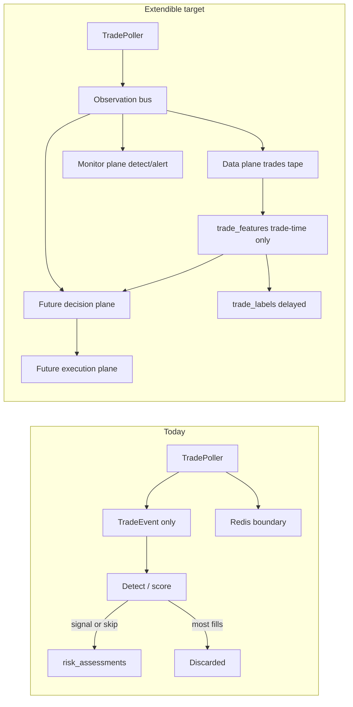
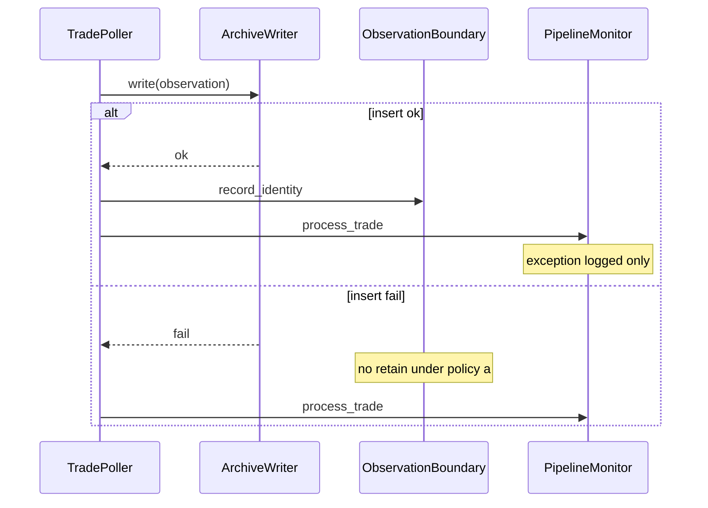

# Research trade archive roadmap

This document is the implementation roadmap for landing [`Data.md`](../Data.md) in this repository as a phased Spec Kit series. Normative collection rules, field tables, and the foundation-gap write-up live in `Data.md`. This roadmap owns how we sequence delivery, how we wire the process, and how we stay extendible for a later authorized trading consumer.

**Status:** Phase A0 has `tasks.md` under [`specs/005-research-trade-archive/`](../specs/005-research-trade-archive/). Next: `$speckit-analyze` → human validation (T001) → implement. Keep this roadmap aligned with the slice plan rather than maintaining a conflicting fork.

## Work queue

| ID | Item | Status |
| --- | --- | --- |
| update-specs-readme | Keep [`specs/README.md`](../specs/README.md) execution order and activation examples aligned with archive slices (`005`–`009` — `005` directory exists; re-verify when `006`+ directories are created) | **done 2026-11-18** for `005` activation path; keep pending re-verify for `006`+ |
| register-archive-gaps | **First-class before implement:** add owned A0 (and prerequisite 001/003 amendment) rows to [`specs/audit/gap-register.md`](../specs/audit/gap-register.md); map disposition to slices; update through converge. Do not treat gap-register as optional prose | **done 2026-11-17** — registered G-035–G-043 (A0 + 001/003 prereqs); slice map extended for proposed `005`–`009`; A1–D deferred in Proposed Deferrals. Keep dispositions updated through converge |
| amend-001-boundary | Own a slice 001 amendment to `observation-boundary.md` / `status-and-config.md` for identity-retention timing, fan-out failure isolation, and any write-failure / reconciliation loss vocabulary before archive implement | **done 2026-11-18 (contract)** — policy (a) + stall + fan-out encoded; runtime still retain-always until 005 implements. Next: `amend-003-health` |
| amend-003-health | Own a slice 003 amendment to health/`/ready` for an archive tape component (degraded vs down, backlog SLO) when archive writing is enabled — reject “leave /ready alone” | **done 2026-11-18 (contract)** — `trade_archive` + provisional SLOs in health-endpoints; runtime until 005. Next: `specify-005-a0` |
| specify-005-a0 | Author Spec Kit slice for Phase **A0** only: observation bus, durable `trades`, gap durability, identity handoff — depends on amended 001 and 003 health contracts; no blocking Gamma/Jev on the insert path. Activate with `SPECIFY_FEATURE_DIRECTORY=specs/005-research-trade-archive` only after the directory exists | **done 2026-11-18** — through analyze + remediation; **human validation 2026-11-20** (T001). Next: `$speckit-implement` |
| specify-006-a1 | Author Spec Kit slice for Phase **A1**: versioned `markets`, **Gamma outcome repair + KPI first**, then knowability caches / optional Jev — async / non-blocking relative to A0 emission | pending |
| outcome-repair-kpi | Wire `outcome_repair_status` metrics/alarms; gate Phase C primary labels on repair quality (see Data.md Outcome-repair quality) | pending |
| label-schedule-fidelity | Phase C: durable due-queue + catch-up for +5m/+1h/+24h (and resolution) label arms; persist `label_schedule_*`; KPI beside tape gaps; primary gate (see Data.md Label schedule fidelity) | pending |
| clarify-handoff | After the 001 amendment path is owned: adopt the Data.md **Observation fan-out contract** (sequence diagrams + isolation matrix) into `observation-boundary.md`; encode locked policy **(a)** + checkpoint stall; reject marker-only, retain-always single callback, and 005-local parallel proof. Fingerprint/`log_index` stays Phase B. | pending |
| defer-fingerprint | Phase B owns strong vs weak fill fingerprint + `fingerprint_version`; A0 insert key stays `(trade_ts, observation_id)`; optional provisional weak column for rematerialization only. Fingerprint-dependent market aggregates are not primary-analysis-ready until B locks (see Data.md Canonical tables). Observation grain ≠ match grain is already correct for the tape. Also Phase B: **order as-of enrichment** (`live_as_of` vs `fully_enriched`) so rule-6 burst/rank/canonical-leg does not silently disagree with live after receipts | pending |
| burn-in-policy | Encode `archive_start_at` burn-in (calendar horizon + `data_complete` rate) in A0/B analysis contracts and exports; windowed Core features not analysis-ready before burn-in | pending |
| plan-schema-a0 | Plan A0 Alembic (`trades`, `ingest_gap_events` per Data.md gap schema), idempotent insert contract, write-failure vs ingest-loss `data_complete` behavior, and provisional partition/index/retention/disk budget | **done 2026-11-18** — `005` `plan.md` / `data-model.md` / `contracts/archive-persistence.md` |
| implement-tape-a0 | Implement the A0 archive writer and its tests while keeping the monitor path compatible — **only after** `register-archive-gaps` and the 001/003 amendments are owned | pending |
| defer-a1-b-d | Register A1 and Phase B through D slices and gaps without implementing them in the A0 slice | pending |
| extensibility-planes | Encode the data, decision, and execution plane boundaries in the A0 specification so future trading can plug in without a rewrite | **done 2026-11-18** — FR-018 / User Story 5 in `005` spec; keep plan from inventing dormant execution modules |

## Does this work if you later want to trade?

Yes, if we keep the planes separate and treat execution as a later approved change to the product boundary. The Phase A through D archive is the right foundation for a future trading consumer. It does not already authorize trading.

Today the [constitution](../.specify/memory/constitution.md) requires research and monitoring only. The project must not place trades, simulate trades as real, recommend trades, or automate trades without a separately approved specification, and almost certainly a constitution amendment. Given that boundary:

- Build the data plane now—the durable tape, features, and labels—so offline research and later live decisions share one leakage-safe contract.
- Keep decision logic (scoring or policy) and execution (order placement) as replaceable consumers behind interfaces. Do not mix them into the archive writer.
- When you are ready to trade, open an explicit Spec Kit slice (for example a later `009-execution` slice) that consumes trade-time features only. Do not add a trader inside slice 005.

This approach is more extendible than storing fills only inside `risk_assessments` or teaching the alert path to place orders.

## Recommendation (defaults)

**Topology.** Stay in the same checkout and share one `TradePoller` with a multi-consumer fan-out. One acquisition cycle feeds N consumers: a required archive writer, the existing detect-and-alert `Pipeline` for monitoring, and later a decision or execution consumer on the same observation bus. Do not reinvent polling or the Redis complete-through boundary.

**First delivery (Phase A0).** Create a Spec Kit slice (proposed name `005-research-trade-archive`) that lands **only** the observation bus, durable `trades` inserts, and durable ingest-gap copy. Store section 1 fields from the API row and cheap derived logic—including Feasible=Partial API fields such as raw `outcome` / `outcome_index`. Do **not** put blocking Gamma admit/repair, knowability caches, or Jev-on-miss on the A0 hot path.

**Immediate follow-on (Phase A1).** A separate slice (proposed `006-versioned-markets-knowability`) owns versioned `markets`, **Gamma outcome repair first**, then series/template caches and optional Jev-on-miss. Classification/repair never blocks A0 emission or `trades` insert; unclassified fills persist as `unknown` and may be upgraded later. Track `outcome_repair_status` as a first-class KPI—Phase C labels must not run as primary while thin API outcomes stay unrepaired at scale (see `Data.md` Outcome-repair quality).

**Why split the old Phase A.** Bundling bus + tape + markets + Gamma + caches + Jev into one first slice is too heavy for Spec Kit bounds and risks starving the 5s all-participant poll on metadata cold starts. “Knowability does not run per fill” does not make Gamma free. Prefer A0 then A1 over a single mega-A with only soft SLOs.

Featuring, Dune, labels, and retention remain later phases. `Data.md` keeps live scoring out of scope for collection.

**Why not bolt this onto slices 001 through 004.** Those slices own monitor contracts such as ingest proof, readiness, dry-run deduplication, and truthful scoring. A full research warehouse changes schema, retention, and workload shape. The constitution wants bounded slices and migration paths, so a new owned gap set and a new slice is the honest path.

## What the repo is today versus what Data.md needs

The normative write-up of the gap and the required fix lives in [`Data.md`](../Data.md) under **Repository foundation gap and required fix**. That section includes collection rule 8 (assessments are not the tape), the Phase A through E table, and the recommended clarify defaults.



### Required Phase A fix (blocking; matches Data.md)

1. **There is no Postgres trades tape today.** Quiet fills leave no durable row, so market windows, denominators, and `data_complete` analysis cannot be rebuilt from storage. That blocks collection quality and any later trading consumer that needs honest market context.
2. **The handoff currently delivers `TradeEvent` only.** [`trade_poller.py`](../src/polymarket_insider_tracker/ingestor/trade_poller.py) calls `on_trade(observation.event)` and drops the slice 001 `identity`. Archive inserts need that identity as `observation_id`. `Data.md` binds that field to the identity defined in [`specs/001-supported-trade-ingestion/data-model.md`](../specs/001-supported-trade-ingestion/data-model.md).
3. **The fix.** Emit `TradeObservation` on an observation bus. Insert into `trades` idempotently on `(trade_ts, observation_id)`. Persist versioned `markets` rows and durable gap markers. Fan out to the monitor path, and later to decision or execution consumers, without making the archive depend on those consumers. Do not use `risk_assessments` as the fill grain. Lock write-failure versus identity retention in clarify (see below); do not ship marker-only advance.

## Extensibility contract (design now, execute later)

We treat the system as three planes. Only the data plane ships in archive slices `005` through `009` (A0–D).

| Plane | Responsibility | Now | Later trading |
| --- | --- | --- | --- |
| **Data** | Ingest, durable tape, versioned dimensions, trade-time features, and delayed labels | Phases A through D | Remains the unchanged source of truth |
| **Decision** | Policy or model that maps trade-time features to intent (alerts today; size and side later) | The monitor scorer stays; research stays offline | A new consumer of `trade_features` and live observations |
| **Execution** | Place, cancel, and risk-limit orders, and keep an execution ledger | Out of the product | A new slice after a constitution amendment |

These hard rules keep a future trading slice from forcing a rewrite:

1. **Stable observation bus.** Consumers subscribe to `TradeObservation`, which carries identity, event, and provenance. They must not depend on ad-hoc `TradeEvent`-only callbacks. Fan-out is ordered and failure-isolated: archive writes must not depend on execution, and execution must not block boundary proof.
2. **Leakage firewall.** Trade-time features (sections 1 through 6, and `trade_features` when materialized) never include that trade’s labels (sections 7 and 8). A future live trader may read only trade-time views. Labels stay for offline evaluation and training targets.
3. **Version everything.** Keep `feature_version`, knowability and policy versions, and source versions on rows so a deployed policy can pin the feature contract it was trained on.
4. **Idempotent, joinable grain.** A0’s durable insert key is `(trade_ts, observation_id)`. Fill fingerprints are a separate aggregate grain for sections 2–6 (Phase B clarify: weak vs `log_index`-strong). An execution ledger joins the public tape via `observation_id`; it does not redefine identity.
5. **No silent incompleteness.** `data_complete` and gap markers travel with windowed features so a trader can refuse to act when the tape is unproven.
6. **Capability flags, not dormant trading modules.** Do not ship unused order-placement code “for later.” Document extension points, and wire execution only under an approved slice. Constitution principle II says library presence is not the same as product capability.

When trading is authorized, expect a separate slice that adds a credentials and wallet boundary, an order client, position and risk limits, dry-run versus live execution modes, and an execution ledger. That slice should consume the data plane rather than fork a second feed.

## Proposed Spec Kit sequencing

| Phase | Slice (proposed) | Owns | Does not own |
| --- | --- | --- | --- |
| A0 | `005-research-trade-archive` (**planned** 2026-11-18) | Observation-bus fan-out; idempotent `trades` insert; durable gap/loss copy; API/cheap-derived section 1 fields; depends on amended 001 boundary; **implements policy (a) recovery** (retain after insert; checkpoint stall)—not markers alone | Versioned markets; knowability model; blocking Gamma; Dune; featuring; labels; execution; marker-only “completeness”; outbox/(b) without a later 001 switch |
| A1 | `006-versioned-markets-knowability` | Versioned `markets`; **outcome repair KPI** (async Gamma `token_id`→label); series/template caches; human overrides; optional Jev-on-miss; regime upgrade from provisional `unknown` | Changing A0 insert/identity semantics; featuring budgets; execution; blocking the poller on Gamma |
| B | `007-featured-enrichment` | Featuring gate: regime in {`always_latent`, `windowed`} and about $5k notional (`unknown` admitted but not featured by default); **regime-upgrade → hot-window featured backfill enqueue** (A1 upgrades regime; B re-evaluates eligible stored fills still in hot); enrichment budget and degrade order; receipt, Transfer-log, and hydrate arms; optional `trade_features`; versioned `wallets` and `proxy_funding`; **lock strong vs weak fill fingerprint** (`log_index` when enriched) for sections 2–6 aggregates; **signed-flow / aggressor KPI gate** before overweighting λ / imbalance; **two wallet-history stories** + `wallet_hydrate_status` stratification | Monitor thresholds and alerts; execution; featuring `unknown` without a versioned policy bump; insert-only featuring with no upgrade backfill; treating convention-signed λ as aggressor truth; silent lifetime↔archive wallet-history hybrids; A0 identity redesign |
| C | `008-labels-resolutions` | Delayed `trade_labels` and `market_resolutions`; leakage-safe write schedules; **gated on outcome-repair KPI** (`ok`/`not_needed` for primary win/loss joins); **label schedule fidelity** (due-queue, catch-up, `label_schedule_*` KPI) so +1h/+24h follower/after-trade labels are not quiet-period–biased | Live decision inputs; execution; treating `unrepaired` thin outcomes as Core labels; on-time-only cron cohorts without schedule KPI |
| D | `009-archive-retention` | Hot-to-warm compaction and durable export policy | Product UI; execution |
| E (future, gated) | Execution or decision slice | Order intent and placement after a constitution change and an approved specification | Redefining the public tape |

Register gaps in [`specs/audit/gap-register.md`](../specs/audit/gap-register.md) before implementation (work-queue item `register-archive-gaps`). Activate the intended slice explicitly once its directory exists, for example `SPECIFY_FEATURE_DIRECTORY=specs/005-research-trade-archive`. Keep [`specs/README.md`](../specs/README.md) execution order in sync when slices are specified so operators do not reuse a stale `001`–`004` activation from an earlier session.

**Locked in `Data.md` (2026-11-15):** always admit `unknown` into `trades`; do **not** feature `unknown` by default. Split former Phase A into **A0 then A1**, with the hard rule that admit/Gamma/knowability never block emission or `trades` insert. Featuring §3’s gate is {`always_latent`, `windowed`} plus the notional cutoff. The earlier “advance Redis boundary with a durable gap marker” write-failure default remains **withdrawn**; see Write-failure and identity retention below.

## Phase A0 design (first implementable slice)

### 1. Reuse ingest and widen the handoff

Keep the Redis boundary, the five-second poll, all-participant coverage, and `possible-data-loss` behavior from slice 001.

Extend the emission contract so the archive receives a full `TradeObservation`, including the event, identity, and provenance. Prefer a dual callback or a small fan-out adapter so the existing `process_trade(TradeEvent)` path stays compatible during a deprecation window, as required by constitution principle V.

Archive inserts must be idempotent. The unique key is `(trade_ts, observation_id)`, and duplicates from a restart are no-ops.

**`raw_row_json` is Core (hot-only) in `Data.md`.** A0 must implement a concrete raw-capture path: keep the provider payload on `TradeObservation` (or an equivalent durable handoff) from page parse through idempotent `trades` insert. Do not treat raw as optional because parsing already succeeded, and do not leave Core satisfaction to accident. Structured fields are still stored; raw is additional hot-tier evidence. Disabling raw retention is allowed only via an explicit versioned cost flag that amends Priority/Feasible in `Data.md` for that deployment—default A0 keeps raw on and sizes disk accordingly. Do not invent fields the provider never returned.

### 2. Schema (Postgres, partitioned) — A0 minimum

Align with the canonical tables in `Data.md`, using the **A0** minimum:

- The `trades` table is partitioned by `trade_ts`. Its primary key is `(trade_ts, observation_id)`. It holds section 1 warm fields available at ingest from the API and cheap derived logic—including Partial API fields. Provisional knowability may be `unknown` until A1 upgrades it. Chain- and Dune-backed Partial columns may exist as nullable with status defaults such as `not_attempted` until Phase B wires those arms. Do **not** block A0 on strong-vs-weak fingerprint clarify: market-aggregate fingerprint rules belong to Phase B. An optional provisional weak `fill_fingerprint` (from tx/token/price/size) may be stored for later rematerialization; it must not replace `observation_id`. Correct A0 identity does **not** authorize primary volume/λ/burst studies on provisional weak fingerprints—collisions can silently merge distinct fills; wait for `fingerprint_version` (Data.md fingerprint quality gate).
- An `ingest_gap_events` table stores durable completeness evidence. Normative columns, reason enums, and `data_complete` rules are in `Data.md` **Durable gap / write-failure schema**. In short: copy Redis ingest `loss-events` as `class=ingest_loss` with 001 reasons; record Archive failures as `class=write_failure` with `archive_insert_failed` / `archive_insert_abandoned` at `observation_id` grain. Both classes fail windowed `data_complete`; keep `class` so research can stratify provider holes vs persist holes.
- Do **not** require the full versioned `markets` schema in A0. A1 adds `(condition_id, known_at)` markets rows, knowability regime columns, and cache tables.
- Do not overload `risk_assessments` as the tape. Keep it as the optional later scoring ledger that `Data.md` already allows.

Migrations use Alembic with a downgrade path, and disposable-database proof follows the existing services profile pattern from slice 002.

### 2b. Provisional capacity (A0 plan requirement)

Do not defer all sizing to Phase D. Cold-start plus all-participant coverage can exhaust disk and indexes while compaction is still unbuilt. Normative defaults live in `Data.md` **Provisional capacity**; the A0 plan must restate or revise them with a disk budget.

| Topic | Provisional A0 default |
| --- | --- |
| Partition grain | Daily UTC partitions on `trade_ts`; pre-create ahead; alarm on missing partition |
| Indexes | PK `(trade_ts, observation_id)`; `(condition_id, trade_ts)`; `(proxy_wallet, trade_ts)`; `(transaction_hash, trade_ts)` |
| Hot window | 14 days full detail on primary |
| Interim retain before D | ~90 days on primary (14 hot + 76 warm), then detach (not silent delete) to operator storage / recorded export |
| Growth input until measured | 5×10⁵–2×10⁶ rows/day; **~2.5–10 KiB/row with Core `raw_row_json`** (default); index factor ~0.5–1.5×; safety ≥ 2. Smaller per-row budget only if a versioned flag amends raw off |
| Alarms | Disk 70% budget; missing future partition; insert rate 2× sizing input; backlog tied to tape health |

Phase D automates compaction/export and may shrink primary footprint. A0 acceptance still requires the budget, indexes, partition strategy, and interim retain/detach assumption to be written and provisioned.

### 3. Knowability deferred to A1 (never blocks A0)

Under the `Data.md` admit policy, all regimes—including `never_early` and `unknown`—enter `trades`. A0 may insert with `unknown` when classification is not ready. A1 resolves Gamma metadata (extend or share `metadata_sync` patterns), persists versioned `markets` rows, supports series/template caches and human overrides, and may call a cheap decision model such as Jev only on cache miss—behind an interface, asynchronously relative to the insert path.

**Hard rule:** A1 work must not stall the five-second poll, observation emission, or A0 `trades` insert. Cold-start Gamma latency is an A1 scheduling problem, not an A0 back-pressure lever.

The featuring gate stays out of A0/A1 except that A1 stores the regime so Phase B can query it. Phase B must use the locked gate: feature only {`always_latent`, `windowed`} above the notional cutoff; leave `unknown` on the tape without priority enrichment unless a later versioned policy explicitly opts it in.

**Featuring is a cost gate, not a recall guarantee.** Mid-size / clustered small prints often miss funding, hydrate, receipts, and wash edges. Full-tape denominators remain valid; **wash-adjusted** stats are demoted from Core to Useful/Partial in `Data.md` so Core does not overclaim. Re-promoting wash-cleaned volume to Core needs a separate coverage decision. Independent both-leg featuring can also double spend on one match and leave small opposite legs unenriched—tape pairing helps counterparties; receipt wash does not. Noted in `Data.md` Featuring; no A0/A1 gate change; Phase B chooses dedupe / pair-assist / accept.

**`unknown` at insert ≠ forever unfeatured.** Under A0→A1 async classification, early large fills on a slow-to-classify market must be re-evaluated when the regime upgrades to `{always_latent, windowed}`—enqueue featured enrichment for gate-passing rows still in the **hot** window. Not global tape backfill. Locked in `Data.md` Featuring; Phase B acceptance requirement.

### 4. Process wiring — failure-isolated fan-out (precise)

Today’s code is a **single** `on_trade(TradeEvent)` callback; [`_deliver_one`](../src/polymarket_insider_tracker/ingestor/trade_poller.py) retains identity even when that callback raises. “Ordered, failure-isolated bus” is not satisfied by prose. Normative contract, exception matrix, deprecation adapter, and sequence diagrams live in `Data.md` under **Observation fan-out contract**.

**Locked summary (soft-preferred policy a):**

| Question | Answer |
| --- | --- |
| Order per observation | Archive → Monitor → (future decision/execution slot) |
| Does Archive exception isolate from Monitor? | Archive failure is recorded; Monitor is **still invoked** (must not assume tape durability). Identity is **not** retained under (a). |
| Does Monitor exception isolate from Archive? | **Yes.** Monitor errors are logged only; they must not undo a successful insert or revoke identity. |
| Who owns `EMITTED` / `record_identity`? | Amended 001 delivery step, authorized by **Archive durable success** (a) or **Archive/outbox accept** (b)—never by Monitor return. |
| Legacy `on_trade(TradeEvent)` | Deprecation adapter: wrap as Monitor behind the fan-out driver. Archive-enabled runs must not use “single callback retain-always.” |



A0 plan/tests must encode these sequences (happy path; archive fail; monitor fail after archive ok; crash between insert ok and `record_identity` with idempotent re-delivery). Archive persistence failures must also feed the dual-use health model below.

### Write-failure and identity retention (slice 001 contract amendment)

This is **not** a local 005 clarify detail. It amends slice 001’s observation-boundary contract.

Slice 001 today states in [`observation-boundary.md`](../specs/001-supported-trade-ingestion/contracts/observation-boundary.md) (and status surfaces in [`status-and-config.md`](../specs/001-supported-trade-ingestion/contracts/status-and-config.md)):

- identity is written after the trade callback returns;
- the checkpoint advances after the whole proven page is delivered;
- loss reasons are `{horizon-expired, restart-beyond-horizon, continuity-mismatch}`.

[`TradePoller._deliver_one`](../src/polymarket_insider_tracker/ingestor/trade_poller.py) matches that: it calls the consumer callback, logs callback errors without failing retention, then unconditionally `record_identity`s. After identity is retained, a later checkpoint advance means a restart will not re-emit that fill.

If Phase A inherits retain-on-callback-return and only adds “advance Redis plus a durable write-failure marker,” incompleteness becomes **visible but permanent**. That contradicts `Data.md` rule 1 and the archive’s reason for existing.

**Rejected:**

- advance-with-marker with no reconciliation or retry arm;
- implementing write-failure markers, fan-out failure isolation, or a new identity-retention rule only inside 005 without amending 001 (silent break of 001 semantics or an unauthorized parallel proof model).

**Ownership.** Before archive implement, own a slice 001 contract amendment (gap-register / tasks / evidence as required) updating at least `observation-boundary.md` and ingest status. A cross-slice note in 005 is fine only if it still names **001 as the boundary owner** and points at the amended contract. 005 consumes the new semantics; it does not redefine them.

**Locked (2026-11-18):** policy **(a)** — retain identity only after durable archive insert. Soft preference for **(b)** is withdrawn as the A0 path; switching to outbox reconciliation needs a later versioned 001 amendment.

**Checkpoint under (a):** stall the Redis complete-through boundary past observations that are not yet archive-durable; retry with backoff. Escalate archive health `degraded` → `down` per `Data.md` Dual-use health SLOs. **Rejected:** advancing anyway during a long outage to “keep the poller moving.”

**Provisional tape ready SLOs** (encode in 003 amendment; revise with ops): `degraded` if any owed insert is older than 30 seconds or any insert failed in the last 60 seconds; `down` (fail `/ready`) if any owed insert is older than 5 minutes or all attempts failed for 5 minutes with at least one attempt; quiet markets with no attempts and no backlog stay `up`.

### Recovery beyond markers (A0 acceptance)

`data_complete` and gap / write-failure markers are necessary but **not sufficient** for Phase A0 acceptance. Markers do not put rows back on `trades`, so they cannot restore denominators or windowed Derived features by themselves. Normative detail lives in `Data.md` under **Recovery story for write-failed / gap-marked rows**.

| Chosen 001 policy | Restore path A0 must implement | Durable artifact besides the marker | Permanent hole |
| --- | --- | --- | --- |
| **(a)** | Re-emit from live acquisition until idempotent insert succeeds (identity retained only after insert) | No outbox required; Core hot `raw_row_json` still required for forensics (not the primary restore path) | Unreachable / past recovery horizon without a durable row → marker stays, `data_complete=false`, rate/SLO alarms; denominators **not** restored |
| **(b)** | Bounded reconciler reading a durable outbox (payload sufficient for idempotent insert)—not global historical backfill | Outbox + marker; success clears or narrows marker | Abandon after retry/SLO budget → same permanent treatment |

**Rejected:** markers-only acceptance; “permanent-with-alarms only” as the A0 default; advance-anyway under (a); treating hot raw as the primary restore path; shipping A0 without a concrete `raw_row_json` capture path while `Data.md` still marks that field Core.

A0 tests must prove: restore succeeds for injectable write failures; exhausted cases alarm and leave `data_complete=false`; successful restore makes the identity available again for denominator rebuilds.

Optionally, later split archive and execution into separate CLIs that share modules if operators want isolation or different credential boundaries. Those CLIs must still share the same observation and feature contracts.

### 5. Dual-use health and `/ready` (003 amendment — not untouched)

**Withdrawn:** “leave slice 003 `/ready` alone.” Postgres is required for `/ready` today; after A0 it is also the trades tape. Archive failures that are only logged produce a ready monitor with a dead research archive.

**Locked model** (details normative in `Data.md` **Dual-use health and `/ready`**):

- When archive writing is enabled, add a first-class tape component (`trade_archive` / equivalent) with `up` / `degraded` / `down`.
- Postgres unreachable → still fails `/ready` (existing 003).
- Sustained tape insert failure or backlog beyond a versioned SLO → component `down` → **fails `/ready`**.
- Short transient failure inside the SLO → `degraded` → `/ready` may stay true (same pattern as ingestion `degraded`).
- Assessment persist failure remains separate: observable, **must not** block alerts (constitution IV), and does **not** by itself mark the tape component `down`.
- Monitor-only mode (archive disabled) keeps current 003 readiness without the archive component.
- Own this as a **slice 003** health/lifecycle contract amendment (or a cross-slice contract that still names 003 as health owner). A0 consumes it; it does not invent a parallel readiness channel.

Still leave alone initially: slice 003 dry-run and deduplication behavior (except where fan-out isolation is already required), slice 004 scoring-honesty work, and alert channel implementations. Do not backfill the historical global tape. Do not add trading execution or shadow trading (constitution I).

## Access and compute topology (read path)

The full admitted tape will not fit on a typical laptop disk. Do not design “download everything locally” as the research path.

```text
Collector → remote PostgreSQL (hot / warm facts)
                ↓ Phase D compaction / export
         object storage (Parquet or similar, partitioned by trade_ts)
                ↓
    Analyst machine: query over the network, or pull one day / market / sample
```

| Access pattern | Use |
| --- | --- |
| Remote Postgres over SSH, VPN, or a managed database | Interactive SQL, operations, and hot-window checks |
| Partitioned Parquet in object storage | Bulk scans; open one day or one `condition_id` with DuckDB or Polars |
| Narrow extracts such as `trade_features`, labels, or training samples | Local modeling when the full tape is too large |
| Live decision or execution in Phase E | Online trade-time views or a hot window; not a full archive sync to a laptop |

Phase D owns export policy details. This section only freezes the principle: the warehouse stays remote, and local machines query it or pull samples.

## How this maps to open docs

| Doc | Role |
| --- | --- |
| [`Data.md`](../Data.md) | Normative research schema and collection rules, including the foundation gap, Phase A fix, Phase A through E delivery table, and clarify defaults. This is the primary input for slice 005 and later archive slices. |
| [`data-collection-primer.md`](data-collection-primer.md) | Human primer. Keep it aligned with `Data.md`, but do not treat it as a second contract. |
| Specs 001 through 004 | Ingest proof, runtime, operations, and detection. They are dependencies, not the archive owner. |
| [`risk_assessments` models](../src/polymarket_insider_tracker/storage/models.py) | Monitor evidence. They may join later, but they are not the fill grain under `Data.md` rule 8. |

## Suggested next concrete steps

1. Update [`specs/README.md`](../specs/README.md) proposed order (done for proposed `005`–`009`; refresh activation examples again when `005` is actually specified).
2. **Register archive gaps** in [`specs/audit/gap-register.md`](../specs/audit/gap-register.md) for A0 and the prerequisite 001/003 amendments before implement. Keep dispositions slice-owned.
3. Own the **slice 001 boundary amendment**: update `observation-boundary.md` / ingest status (and gap-register / tasks) for identity-retention timing, fan-out failure isolation, and any write-failure or reconciliation vocabulary. Choose **(a)** or **(b)** as part of that amendment. Reject marker-only and any archive-only parallel proof model.
4. Own the **slice 003 health amendment** for archive-enabled runs: tape component, degraded vs down, backlog SLO, `/ready` failure when the tape is `down`, and the constitution IV split (assessment persist must not block alerts). Reject “leave `/ready` alone.”
5. Run `$speckit-specify` for Phase **A0** (`005-research-trade-archive`) only: bus, `trades`, gap durability. Set `SPECIFY_FEATURE_DIRECTORY=specs/005-research-trade-archive` on every command. Depend on the amended 001 and 003 contracts. Do not pull A1 markets/Jev into that specification.
6. Clarify A0 items: `TradeObservation` fan-out shape (and raw-capture handoff). Do **not** pull fingerprint/`log_index` aggregate rules into A0 clarify—park them in Phase B / `defer-fingerprint`. Do not re-open `unknown` featuring.
7. Produce the A0 plan, an Alembic sketch for `trades` + gap events (and outbox tables if (b)), insert/idempotency/recovery contracts, **and** provisional partition/index/retention/disk budget (see §2b). Consistent with amended 001 loss/status and 003 health. Encode admit/Gamma never blocks emission. State the restore path explicitly—not markers only.
8. Implement A0 only after gap-register rows exist: deterministic tests (fake trades source → Postgres; injectable write failure → restore; exhausted → alarms + `data_complete=false`; ready fails when tape is `down`). No live Discord.
9. Specify and implement **A1** (`006-versioned-markets-knowability`) as a separate slice with non-blocking classification and regime upgrade from provisional `unknown`.
10. Only then open Phase B featuring and enrichment.

## Risks to manage explicitly

**Volume.** An all-participant global tape is heavy. A0 must ship with provisional daily partitions, index sketch, ~90-day interim primary retain/detach, disk budget, and alarms—not a qualitative warning that “Phase D will handle it.” Recompute rows/day after 72h of live metrics.

**Phase A overload.** Do not re-bundle A0+A1 into one first slice. Metadata cold starts on a 5s poll will starve acquisition and monitoring if admit blocks emission.

**Ready while tape is dead.** Do not ship archive writes without a 003-owned health component and `/ready` rule. Assessment persist must still never block alerts.

**Leakage.** Phase A must not write section 7 or 8 fields onto `trades` or future `trade_features` rows. A future trader that trains on labels but serves with trade-time features needs this firewall from day one.

**Permanent holes from retain-then-advance.** Slice 001 retains identity even when the callback fails. Pairing that with marker-only boundary advance makes archive write failures unrecoverable. This requires an owned **001 contract amendment** encoding locked policy **(a)** + checkpoint stall—not a 005-local workaround.

**Markers without restore.** `data_complete` and gap markers do not rebuild denominators. A0 acceptance requires the chosen recovery arm (re-emit or outbox) plus explicit permanent-loss + SLO-alarm behavior when restore is exhausted.

**Cold-start burn-in.** No global backfill means early windowed Core features are systematically wrong, not merely sparse. Persist `archive_start_at`; do not treat 24h/7d denominators, λ, burst, or ranks as analysis-ready until the versioned burn-in horizon (and completeness threshold) in `Data.md` **Cold-start burn-in policy**. Fill facts on `trades` remain usable immediately.

**Same-second order vs receipts.** Rule 6 without `block_number`/`log_index` is unstable: later enrichment reshuffles burst origin, entry rank, and tied canonical-leg picks. Phase B must freeze an **order as-of** contract (`live_as_of` vs `fully_enriched`)—see `Data.md` Collection rules. Do not assume rematerialized warm features equal what a live consumer saw.

**No API aggressor role.** “Prefer taker else rule 6” is a stable convention. Elevate `side` vs `onchain_direction` (and receipt maker/taker when present) from a once-collecting check to a **signed-flow / aggressor KPI gate** before overweighting λ / signed imbalance; `buy_imbalance_1h` demoted from Core until that gate passes (`Data.md` Canonical tables).

**Two wallet-history stories.** Featured page-capped hydrate (`lifetime_*`) and archive-path concentration are incompatible ledgers. Analyses pick one family (or join with strata) and stratify lifetime features on `wallet_hydrate_status`; demote first-trade / share-of-lifetime / skill / standalone lifetime volume from Core until `hit` (`Data.md` section 4).

**Outcome repair vs tape.** A0 without A1 leaves many `outcome_index=999` / empty labels unrepaired. That does not invalidate the tape, but it **does** poison `bet_won`, side-of-market, and Yes-fold until repair runs. Prioritize async Gamma repair in A1 and treat `outcome_repair_status` as a KPI; gate Phase C primary labels on it.

**Label schedule fidelity.** +1h/+24h follower and after-trade labels are biased toward quiet periods if jobs skip or lag without catch-up. Phase C requires a due-queue, post-outage catch-up, and `label_schedule_*` KPI alongside tape `data_complete` (`Data.md` Label schedule fidelity).

**Identity drift.** Never redefine `observation_id`. Size and price canonicalization stay owned by slice 001.

**Dual-purpose load.** Archive RPC and API budgets must not starve the monitor path. Featuring budgets belong in Phase B, not as unbounded Phase A Gamma calls.

**Premature execution coupling.** Baking order placement into the archive writer or the monitor scorer would block Spec Kit review and force constitution exceptions. Keep extension points; do not ship dormant trading modules.

**Governance.** Before Phase E, expect an explicit constitution amendment or an approved product-boundary specification. Until then, “extendible” means the data plane and interfaces are ready, not that live trading is enabled.
